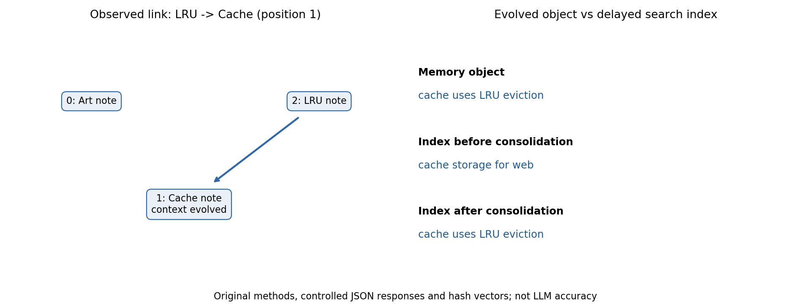

# A-MEM 笔记演化与链接 demo

通过AST加载锁定评测仓库原MemoryNote/AgenticMemorySystem类，执行构造、LLM分析调用、add/process/检索与重建。外部LLM和embedding为可控替代。额外执行系统仓库的原方法，记录错索引和链接截断反例。状态为 **部分成功**。

## 执行

在论文文件夹运行PowerShell：

~~~powershell
& 'C:/Users/hgfhg/.cache/codex-runtimes/codex-primary-runtime/dependencies/python/python.exe' './复现/scripts/demo_amem.py'
& 'D:/anaconda/python.exe' './复现/scripts/plot_results.py'
& 'C:/Users/hgfhg/.cache/codex-runtimes/codex-primary-runtime/dependencies/python/python.exe' './复现/scripts/audit_delivery.py'
~~~

demo/审计用Python3.12.14标准库，绘图用已有Anaconda Python3.7.6/Matplotlib3.1.3，不安装完整requirements。命令无参数、无网络、无API key、无新模型、无GPU/Chroma/Neo4j。每次运行创建新的notes-随机ID.json，results.json指向最新状态；原方法打印被捕获到original_stdout.txt。

评测源码commit：c3bb1ee6d4825b13460dd26be1444b5f870ddb64；系统源码commit：aec6d34c6035d3a8f56df37d741f25e3adcecfea。结果含两个原文件SHA256。

## 输入与实际行为

三条英文构造记忆：Alice画画、Alice建web缓存、Alice增加LRU淘汰。128维词哈希单位向量用于确定性检索，不是MiniLM。Provider识别原分析提示或给定演化轮次，返回预定义JSON；它不会真正理解自然语言。

实际14项检查通过：邻居次序[1,0]与插入顺序不同仍正确定位；生成元数据；新LRU链接整数位置1；缓存context/tags演化；画画context与缓存原文保留；观察旧索引未刷新；k1种子检索访问链接缓存；原consolidate刷新索引；3笔记与3文档对齐；观察evolution_history为空；宿主JSON重载同状态；系统错索引/截断反例。

评测核心6次可控调用（3分析+3演化）完整保存。系统反例另用1次固定响应，并非额外真实LLM调用。构造器用本地替代LLMController/SimpleEmbeddingRetriever；原类方法体未改变。宿主重载用原MemoryNote初始化并重建替代检索器，是教学持久化，不是验证原save/load完整API。

## 两个系统反例

只加载系统原MemoryNote与find_related_memories/process_memory/search_agentic。跳过会重置Chroma的原系统constructor。候选adapter以Chroma字典形状返回cache，但原find_related把局部排名0当全库位置0，process把缓存演化写到art。k1种子LRU的cache邻居append后被最终[:k]截断。结果记录实际错更新对象与返回值；不修补原源码掩盖这些差异。

源文件与脚本、数据库/状态文件、文档链接均由audit_delivery.py复核。局限性检查的true表示确实观察到局限，不表示算法正确处理了该情况。

- [论文解读](../解释.md)
- [执行脚本](scripts/demo_amem.py)
- [结果JSON](outputs/results.json)
- [原方法stdout](outputs/original_stdout.txt)
- [机制图](outputs/mechanism.png)
- [SVG](outputs/mechanism.svg)
- [本地数据计数](../资料/数据核查.json)

没有真实MiniLM、LLM回答、LoCoMo/DialSim得分、百万检索性能、付费或生产可靠性结果。若下一步跑QA，需明确category/k/数据范围，尤其category5是给参考候选的选择题协议。

## 本轮契约与边界核查

在论文文件夹执行：

~~~powershell
& 'C:/Users/hgfhg/.cache/codex-runtimes/codex-primary-runtime/dependencies/python/python.exe' './复现/scripts/trace_contracts.py'
& 'C:/Users/hgfhg/.cache/codex-runtimes/codex-primary-runtime/dependencies/python/python.exe' './复现/scripts/audit_skill_revision.py'
& 'C:/Users/hgfhg/.cache/codex-runtimes/codex-primary-runtime/dependencies/python/python.exe' './复现/scripts/audit_delivery.py'
~~~

&为PowerShell调用操作符；首路径为bundled Python3.12.14，次路径是相对论文文件夹脚本，无CLI参数/环境变量/API key。trace增加NumPy2.3.5（现有runtime），执行原评测类与原SimpleEmbeddingRetriever，后者使用受控二维Encoder/NumPy cosine协作者，未装MiniLM或sklearn。audit_skill_revision核对两仓提交/干净源码、签名、JSON观察和链接；audit_delivery重查旧demo及1986条QA原数据计数，刷新文档哈希。人工内容记录另列，不以脚本通过证明语义自动合格。

实测输出：PASS: 23 boundary checks; 24 signatures。trace捕获原打印到contracts_stdout.txt，不覆盖旧results/notes状态、不运行原main。新增23项包含重复ID索引不齐、阈值0写后失败、坏响应回退失败、部分action残留、负/重复/越界链接，以及原k0返回全部而128adapter返回空。异常由测试刻意触发后捕获，不能将负例通过解释为原输入正确支持。

原save/load仍静态读，真正缓存模型/文件配套未验证。原requirements锁numpy1.24.3/torch2.4.0等，和本轮独立runtime不同；未声称完整环境已兼容。Windows11Pro，物理可见内存15.69GiB、G盘约37.28GiB为本轮资源记录，无CUDA训练/真实provider/schema/MiniLM/Chroma/QA服务。

- [完整方法契约和原代码](../解释.md)
- [23项实测与24签名](outputs/contracts_trace.json)
- [失败打印](outputs/contracts_stdout.txt)
- [人工逐项内容核查](../资料/skill内容核查.md)
- [来源/文件一致性](outputs/skill_revision_check.json)

状态仍**部分成功**，原14项/6评测响应独立保留，真实QA表格与百万性能未复现。