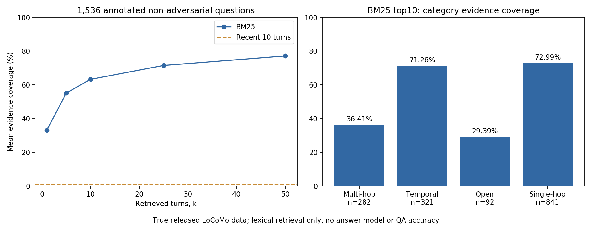

# LoCoMo 真实数据检索与原评分函数 demo

使用官方locomo10.json和原评分函数，跑证据覆盖率及评分规则探针。状态 **部分成功**：数据/指标已实际执行，未运行原DRAGON或LLM答题，不复现初版50组的论文分数。

## 运行

在论文文件夹执行PowerShell：

~~~powershell
& 'D:/anaconda/python.exe' './复现/scripts/demo_locomo.py'
& 'D:/anaconda/python.exe' './复现/scripts/plot_results.py'
& 'D:/anaconda/python.exe' './复现/scripts/audit_delivery.py'
~~~

使用已有Python3.7.6、numpy1.21.6、nltk3.4.5、regex2.5.141、Matplotlib3.1.3，无CLI参数。PorterStemmer不需要NLTK语料下载。没有调用网络、API、GPU、图片或新模型；无需安装官方linux-64 Conda导出环境。源码commit3eb6f2c585f5e1699204e3c3bdf7adc5c28cb376，数据与evaluation.py的SHA256保存于结果。

AST执行原normalize_answer、f1_score、f1、exact_match_score、eval_question_answering。未执行整个evaluation.py的BERTScore等导入，也未运行完整官方eval入口。BM25为本地标准实现（k1=1.5，b=.75），Porter词干和常见词过滤，非DRAGON。

## 真实数据与输出

10组对话、5882轮、272会话、1986问答；类别1/2/3/4/5数量282/321/96/841/446。检索在每组对话单独索引；document只有date/speaker/text/公开caption，查询只接收question，排名后才使用gold evidence评分。原gold answer不进入索引。没有答案生成器。

排除446对抗题和4题空evidence，留下1536题。9处异常evidence无法匹配原turn ID，保留为未命中，不修改数据。每题的evidence/排名ID/分数和例子保存在results.json。

| 方式 | 平均每题证据覆盖率 |
|---|---:|
| BM25 k1 |33.20%|
| k5 |55.19%|
| k10 |63.30%|
| k25 |71.47%|
| k50 |77.08%|
| Recent10 |0.99%|

k10分组Multi36.41%、Temporal71.26%、Open29.39%、Single72.99%。这是证据比例，不能写成问答正确率，且不是原论文模型成绩。Recent10只取最后10条原消息，当前题集多数测试更早信息。

## 指标探针与检查

9项检查通过，包括官方recall与直接ID计算一致、k前缀单调、会话ID唯一、普通F1=0.8、EM忽略词序/重复、额外子答案不惩罚、normalize、对抗关键词与无context默认recall1。

原多答案f1('apple, banana, invented','apple, banana')=1；含not mentioned但后面仍编造的对抗输出也得1；缺context的错答案recall默认1。它们说明指标边界，不是这些答案实际正确。探针不混入1536题平均。真实题prediction设空字符串，仅使用原评分函数的recall字段，不把空F1当模型成绩。

- [论文与代码解读](../解释.md)
- [demo](scripts/demo_locomo.py)
- [逐题结果和数据/代码哈希](outputs/results.json)
- [原评分stdout](outputs/scorer_stdout.txt)
- [检索图](outputs/retrieval.png)
- [SVG](outputs/retrieval.svg)

尚未复现问答LLM、DRAGON、原50组生成、人类编辑、事件FactScore、MiniGPT-5或多模态评测。下一步模型实验需锁定数据与协议，保留空证据/非法ID处理、类别与检索单位、提示词和原始输出。

## 本轮评分契约、截断和真实张量探针

在论文文件夹执行：

~~~powershell
& 'D:/anaconda/python.exe' './复现/scripts/trace_contracts.py'
& '../Titans： Learning to Memorize at Test Time/复现/.venv/Scripts/python.exe' './复现/scripts/trace_pooling.py'
& 'D:/anaconda/python.exe' './复现/scripts/audit_skill_revision.py'
& 'D:/anaconda/python.exe' './复现/scripts/audit_delivery.py'
~~~

&为PowerShell调用操作符；前路径指定解释器，后路径为脚本，无CLI参数。第一/三/四条用已有Python3.7.6及NumPy/NLTK/regex。第二条复用相邻Titans已有Python3.12.14/torch2.14.1+cpu，不下载模型；若venv搬走需用已有相同可用torch环境调整解释器，不声称标准库可运行Tensor探针。

实测第一条PASS: 22 boundaries; 11 signatures。第二条PASS: 5 original mean_pooling tensor checks。评分五原函数/get_input_context AST加载；上下文tokenizer替换word-count，预算全局受控14。池化原体用真实CPU张量执行，原文件全包/编码器未加载。第三条核27观察/12签名、source/file/link，回放一条真实BM25 top50排名和Recent10均值；第四条再查旧1536题/9原检查。人工内容记录独立，脚本不自动评中文语义。

新增错误行为：非空evidence空context IndexError；list预测AttributeError；未知category ValueError；metric不选EM；第一context ID控制粒度；重复evidence不去重；旧会话先占上下文预算、未取回新内容但有DATE2空标题。初19词预算的截断探针可容纳两段而失败，核计词后改14触发限制；未修改原代码。

池化mask二值得[3,5]，全0出现NaN，非二值分子bool/分母数值不一致，输入不变且支持autograd。真实torch梯度测试不是论文模型训练。JSON将NaN现象记录bool，未造有限分数。

两探针不覆盖旧results或重跑真实题answer模型，不下载NLTK语料/图片/API；stdout独立保存。Windows11Pro，物理可见15.69GiB、G盘37.28GiB资源快照；原linux环境/模型未安装，不将兼容隔离函数当完整官方环境。

- [完整契约、原代码与变量流](../解释.md)
- [22项评分/宿主追踪](outputs/contracts_trace.json)
- [5项真实张量追踪](outputs/pooling_trace.json)
- [原打印和失败](outputs/contracts_stdout.txt)
- [逐项内容核查](../资料/skill内容核查.md)
- [来源和文件核验](outputs/skill_revision_check.json)

状态仍**部分成功**：数据证据检索、评分、池化/截断小例已执行，真实QA/DRAGON/初50组/事件/视觉任务未复现。