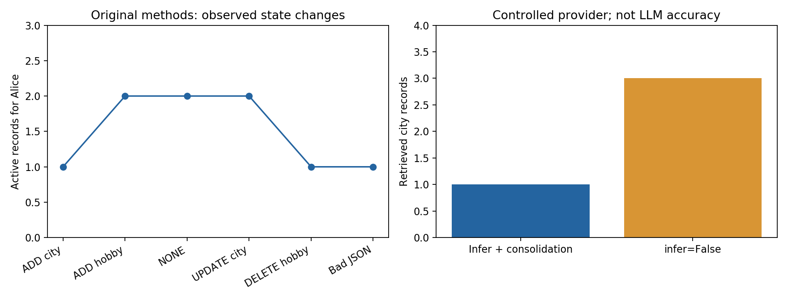

# Mem0 离线机制 demo

直接执行锁定作者项目中的原方法体，配可控模型响应与 SQLite 向量适配器。此实验用于观察抽取—归并—检索的控制流程，状态为 **部分成功**，未复现真实模型或论文 benchmark。

## 运行

在本目录所属论文文件夹执行 PowerShell：

~~~powershell
& 'C:/Users/hgfhg/.cache/codex-runtimes/codex-primary-runtime/dependencies/python/python.exe' './复现/scripts/demo_mem0.py'
& 'D:/anaconda/python.exe' './复现/scripts/plot_results.py'
~~~

第一条为 bundled Python 3.12 解释器 + demo 脚本，没有 CLI 参数；第二条用现有 Anaconda 的 Matplotlib 生成图。无需 API key、模型下载、GPU 或 Neo4j。离线使用本地源码；若换机器需要 Python 3.12、Pydantic 2、Matplotlib 和 SQLite。具体已运行 Python/Pydantic 版本见 results.json。脚本不安装完整 mem0ai。Windows CPU 运行，数据规模为个位数记录，不报告性能基准。

每次运行创建新的 vectors-随机ID.sqlite/history-随机ID.sqlite，results.json 指向最新数据库；旧数据库保留，避免覆盖已有数据。BAD_JSON 日志错误是有意触发的解析失败案例，脚本最终断言全部通过才算本次检查成功。

## 来源与替代边界

源码提交：6d13e8300143b61aefc3a1ab5fb936f6d52008a4。通过 AST 读取原 Memory 的 add、_add_to_vector_store、_add_to_graph、search、_search_vector_store、_create_memory、_update_memory、_delete_memory；加载原 SQLiteManager、MemoryItem、四个消息辅助函数和原提示模板。未修改函数体，来源文件 SHA256 保存于结果。

替代：Memory 构造器和工厂不用；自行注入 Provider、64维词哈希 Embedder、本地 SQLite Vectors。Provider 只接受 city=值/hobby=值/DELETE 键 的教学语法，故所有动作正确性由可控响应决定，不表示自然语言理解准确率。telemetry 为 no-op，pytz.timezone 由 ZoneInfo 适配。图、视觉、agent_id/procedural_memory 路径未运行；完整包 import、SDK、安全隔离、并发和崩溃恢复没有验证。

## 实际结果

13项检查通过，14次 Provider 调用，最终活动记录5条（Alice 1、Bob 1、raw 3）。每一步输入、动作和存储快照均保存。重复城市 NONE 不新增历史；UPDATE 保留 UUID/创建时间；DELETE 活动库删除且历史留标记；Alice/Bob 搜索隔离；非法抽取 JSON 不改存储；infer=False 不调用 Provider、保留3条冲突/重复；缺少身份拒绝；关闭重开后的向量、历史及查询结果完全一致。

其中 DELETE 标记直接查询历史表，因为原 get_history 输出不包含 is_deleted。这项检查证明数据库字段存在，并不证明图关系按论文 invalid 方式保存。

- [可执行脚本](scripts/demo_mem0.py)
- [实际结果与源码哈希](outputs/results.json)
- [状态变化图](outputs/mechanism.png)
- [SVG 图](outputs/mechanism.svg)
- [绘图脚本](scripts/plot_results.py)
- [论文与代码解读](../解释.md)

这些数字是原控制流程的机制验证，不是 LoCoMo/J/F1/BLEU、嵌入质量、吞吐率或生产可靠性结果。要推进真实模型实验，应固定抽取/更新/回答/judge 模型和提示词，记录原对话及问答划分，单独计入记忆写入成本，并保留全部原始回答。

## 本轮契约与失败边界核验

下面在工作区根目录 G:\大模型记忆 执行，Get-ChildItem/Where-Object定位Mem0目录，&调用bundled解释器：

~~~powershell
$p=Get-ChildItem -Directory | Where-Object Name -like 'Mem0*'
& 'C:/Users/hgfhg/.cache/codex-runtimes/codex-primary-runtime/dependencies/python/python.exe' ($p.FullName+'/复现/scripts/trace_contracts.py')
& 'C:/Users/hgfhg/.cache/codex-runtimes/codex-primary-runtime/dependencies/python/python.exe' ($p.FullName+'/复现/scripts/audit_skill_revision.py')
& 'C:/Users/hgfhg/.cache/codex-runtimes/codex-primary-runtime/dependencies/python/python.exe' ($p.FullName+'/复现/scripts/audit_delivery.py')
~~~

第一个脚本使用隔离TemporaryDirectory，不改已交付主DB/结果，直接执行原Memory方法体并记录28个真实签名。退出码0，PASS:14 contract/boundary checks；终端有意显示BAD_JSON与非法动作ID99的错误日志。新证据为[contracts_trace.json](outputs/contracts_trace.json)、[skill_revision_check.json](outputs/skill_revision_check.json)和[内容核查](../资料/skill内容核查.md)。第二个脚本只验证来源、签名、运行结果/文件结构一致性；语义内容依据另行逐条对照，不由机器判定。

实测边界：NONE重复仍2次provider，提取坏JSON仍进入更新；metadata/filters被原地修改；UPDATE不保留未再给出的custom字段；含None值的身份键可通过存在性检查；英文词哈希遇到中文/数字得到零向量，adapter仍返回score=0条目；非法ID后面的有效ADD继续执行；向量成功后注入history失败，已有向量不会回滚。这些观察不能描述成整个库操作原子成功或自然语言理解成功。

资源快照：Windows11专业版，总可见RAM16454352 KiB（约15.69 GiB），G盘空闲37.27 GiB；Python3.12/Pydantic2，CPU、小临时SQLite。没有网络、模型下载/API、GPU或Neo4j需求，秒级检查不代表真实写入/回答延迟。主demo来源和13项原检查/14provider调用/5活动记录保持原样，第三条命令独立重查旧DB及历史。
