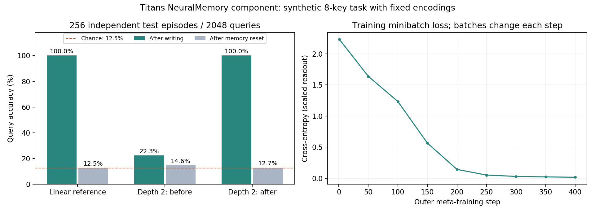

# Titans 关联记忆 demo

本 demo 直接调用锁定的第三方 `NeuralMemory`，以一个可核对的小任务展示“写入的信息会改变之后的查询”，并把线性退化情形和两层深记忆区分开。暂时不制作论文全文翻译。

## 1. 怎么运行

从 `G:\大模型记忆` 的 PowerShell 运行：

~~~powershell
& '.\Titans： Learning to Memorize at Test Time\复现\.venv\Scripts\python.exe' '.\Titans： Learning to Memorize at Test Time\复现\scripts\demo_associative_memory.py' --steps 400
~~~

解释器和全部依赖已在该论文的隔离环境中。命令会先检查仓库提交，然后执行线性参考、两层记忆的外层训练和测试，将结果写到 `复现/outputs`。没有 API key、付费调用或预训练权重下载。当前路径有中文和空格，PowerShell 的引号和调用运算符 `&` 要保留。

主程序只依赖现有 PyTorch 环境；命令从自身路径找到源码，所以也可以用完整路径从其他目录启动。若没有重新训练，可直接打开 [本次结果](outputs/demo_report.html)、[结果图](outputs/demo_summary.png) 或 [JSON](outputs/demo_results.json)。

## 2. 这个任务是什么

每个 episode 有 8 个地址和 8 个值。地址与值分别用 one-hot 向量表示：只有一个分量为 1，其他为 0。每个 episode 都重新生成地址到值的随机排列，并打乱写入顺序。这样训练模型不能靠固定的“key_0 永远对应 value_0”来完成任务。

一个写入 token 是 16 维向量：前 8 维表示 key，后 8 维表示 value。固定的投影把 key 和 value 分开送到神经记忆。查询 token 只含 key，后 8 维全为 0；正确 value 仅在写入阶段提供，在评测阶段才用于计算正确率。

例如保存的第一组测试 episode：

| 地址 | 写入目标 | 两层模型读出 | 重置后读出 | 更新后的目标 | 更新后读出 |
|---|---:|---:|---:|---:|---:|
| key_0 | 7 | 7 | 2 | 0 | 0 |
| key_1 | 5 | 5 | 3 | 5 | 5 |
| key_2 | 3 | 3 | 5 | 3 | 3 |
| key_3 | 4 | 4 | 3 | 4 | 4 |
| key_4 | 0 | 0 | 2 | 0 | 0 |
| key_5 | 1 | 1 | 2 | 1 | 1 |
| key_6 | 2 | 2 | 1 | 2 | 2 |
| key_7 | 6 | 6 | 3 | 6 | 6 |

同一个 key 的答案来自当前 episode 的快记忆，重置后这些答案丢失。更新实验只把 key_0 的值改为另一类，其他 key 的目标保持不变。

## 3. 两个版本分别演示什么

**线性参考**：使用真实 `MemoryMLP(depth=1)`，初始记忆矩阵为 0，关闭动量，遗忘率设得近似 0。它用于核对最基本的 KV 写入。不是另写一个字典来代替神经记忆。

仓库损失为特征维均值，线性矩阵采用行向量约定：

$$L(W;k,v)=\frac{1}{D}\|kW-v\|_2^2,\qquad
\nabla_W L=\frac{2}{D}k^\top(kW-v).$$

此处 $D=16$，one-hot key 范数为 1。步长选 $D/2=8$，使零矩阵的一次梯度写入得到对应行的 value；互相正交的不同 key 不会改同一行。仓库 `max_lr=16`、步长 bias=0，因而实际步长是 $16\times\operatorname{sigmoid}(0)=8$。更换一个 key 的 value 时，对已有矩阵求梯度可以移除旧预测并写入新目标。它是方便检查的受控线性特例，不能被当作深层模型性能。

**两层深记忆**：使用 `MemoryMLP(depth=2, expansion_factor=2)`，保持随机初始化、动量和遗忘机制，固定语义清楚的 Q/K/V 编码。外层训练初始快权重，以及步长、动量和遗忘生成器，让内层 KV 重构梯度有助于查询。没有 attention 和 persistent KV；这是 Titans 的 LMM 组件 demo，而不是完整 MAC 模型训练。

两层结构是 $\operatorname{GELU}(xW_1)W_2$，$W_1$ 为 `[16,32]`，$W_2$ 为 `[32,16]`。为了让编码可核查，关闭 pre/post norm 和 memory residual-normalization 包装器；这些设置与论文的全部默认细节不同。

外层优化器为 Adam，LR 0.003，400 步，每步 16 个独立生成的 episode。查询读出取前 8 维作为类别得分，乘 8 后计算交叉熵；这个缩放属于 demo 的读出设置，不是论文原始语言模型指标。内层使用仓库的均方关联损失，不把交叉熵作为内层写入损失。

## 4. 形状怎么变化

| 阶段 | 类型/形状 | 对应代码 |
|---|---|---|
| 目标随机排列 | 整数 `[B,8]` | `episode` 中 `randperm` |
| 写入顺序 | 整数 `[B,8]` | 每个 episode 独立打乱 |
| 写入 token | 浮点 `[B,8,16]` | 拼接 key/value one-hot |
| 查询 token | 浮点 `[B,8,16]`，后半为 0 | `episode` 返回 queries |
| 最后快权重 | 按参数名组织；每样本一份矩阵 | `state.states[0]` |
| 单查询打包 | 浮点 `[B×8,1,16]` | `read_all` |
| 快权重复制 | `[B×8,1,...]` | 每个 key 使用同一 episode 的最终状态 |
| 读取向量 | 浮点 `[B,8,16]` | 仓库 `retrieve_memories` |
| 类别得分 | 浮点 `[B,8,8]` | 取读取向量的前半部分 |
| 预测类 | 整数 `[B,8]` | 沿类别维 `argmax` |

`read_all` 只调用读取方法，不写入查询。这避免“问一个问题时又把答案写进去”造成混淆。重复快权重是为了让仓库的单-token读取接口批量处理 8 个 key，不增加原本的记忆容量。外层训练时保留这一读取路径的梯度。

关键函数：

- `make_memory(depth, linear=False)` 创建原仓库模块并配置固定投影；线性版本才清零初始矩阵。
- `episode(batch, generator)` 返回写入序列、无 value 的查询、只供评测的标签。
- `final_state(mem, writes)` 调用真实 forward，返回包含快权重的状态。
- `read_all(mem, queries, weights)` 用给定权重读取，不优化或覆盖参数。
- `train(mem, steps, batch)` 外层反向传播、裁剪梯度并执行 Adam；每步都使用新的随机 episode。
- `evaluate(mem, batch=256, seed=101)` 计算写入、重置、换上下文和修改一个地址的对照结果。

更新实验显式传回旧 `state`，并设置 `ttt_batch_size=1`，确保新增的一个 token 真正刷新梯度参考状态，没有仅留在不完整的缓存中。

## 5. 实际结果与证据

结果来自锁定提交 `ce7da9e9a7909e95c8249ceece7c88000bc2c0b9`、PyTorch 2.14.1+cpu、2 个 CPU 线程。模型初始化 seed=31，训练生成器 seed=2026，测试生成器 seed=101。测试 256 个 episode，每个查询 8 个地址，共 2048 次查询。

| 设置 | 写入后查询 | 重置后查询 | 新随机映射 | 改一个 key | 未改的其他 key |
|---|---:|---:|---:|---:|---:|
| 线性参考，无外层训练 | 100% | 12.50% | 100% | 100% | 100% |
| 两层模型，外层训练前 | 22.27% | 14.55% | 20.02% | 32.03% | 19.53% |
| 两层模型，400 步后 | 100% | 12.74% | 100% | 100% | 100% |

前 3 项每项使用 2048 个查询；“改一个 key”使用 256 个查询；“未改的其他 key”使用 1792 个查询。八分类均匀随机猜测的期望为 12.5%。小样本中的重置准确率不必精确等于期望。

记录中的训练 minibatch loss 从 2.2318 降到 0.01681，每个点来自不同训练 batch；图中的线不是同一组验证数据的 loss。主程序内部计时约 10 秒，不包含程序导入耗时，也不是可跨机器推广的速度测量。

本次还重新加载保存的 checkpoint，在相同测试种子上重新求值，五项指标与 JSON 差异全部为 0，见 [checkpoint 核对](outputs/demo_checkpoint_check.json)。checkpoint 是这里合成训练产生的 `synthetic_memory_demo.pt`，不是原论文权重。

## 6. 这些结果不能说明什么

这是一组有限、正交、无噪声的 one-hot 地址，只有 8 个 key；编码规则已经固定，写入目标由生成器给出。它不包含自然语言抽取、检索噪声、冲突的多次长期演化、百万 token 压缩、MAC attention 或真实用户会话。100% 是这个受控任务的结果，不能宣传为一般长上下文记忆能力。

两层版本同时开启动量和遗忘，只说明这种设置可以完成任务；本次没有以消融证明每个模块贡献的大小。换新随机映射和重置对照支持答案依赖快状态，但不是任何输入分布都能泛化的证明。训练与测试使用不同随机种子，未去重所有有限排列，不能声称每个测试排列都从未在训练中出现。

本 demo 配合已有随机小 MAC 前向/反向检查。原论文完整预训练与 RULER/BABILong 指标仍未复现；复现状态为“部分成功”。暂不做论文全文翻译。

## 7. 文件入口

- [可运行主脚本](scripts/demo_associative_memory.py)
- [详细 JSON](outputs/demo_results.json)
- [HTML 结果页](outputs/demo_report.html)
- [PNG 结果图](outputs/demo_summary.png) / [SVG](outputs/demo_summary.svg)
- [checkpoint 核对](outputs/demo_checkpoint_check.json)
- [已有五项最小检查](README.md)

图由 `scripts/plot_demo.py` 从保存的 JSON 生成。本次使用默认 Anaconda Python 的 Matplotlib 3.1.3；独立 PyTorch 环境不要求安装 Matplotlib，主脚本自带 HTML 报告。若重新训练而没有运行画图脚本，HTML/JSON 会更新，PNG/SVG 会保留旧版，不能混用作为同一次结果。
