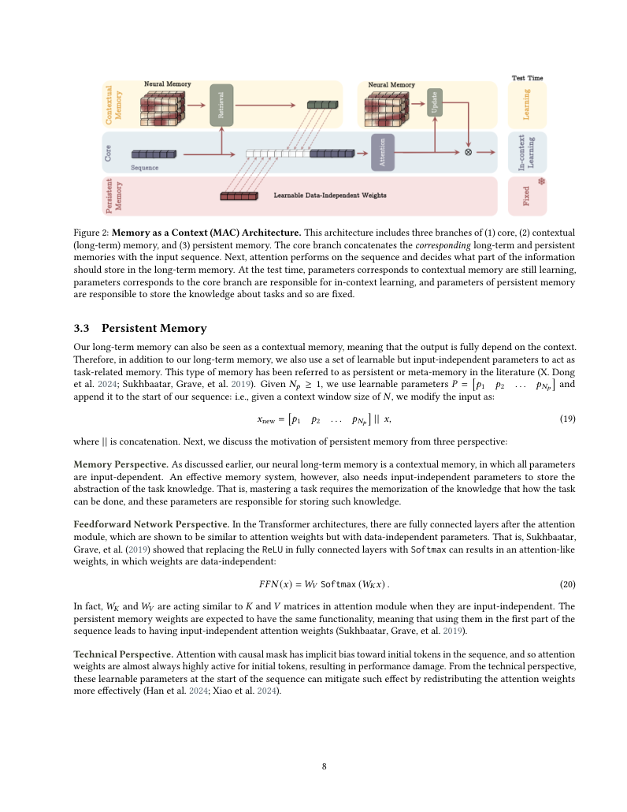

# Titans：论文与代码精读

Titans 的主张是：让局部 attention 精确处理眼前的信息，再用一个会在序列处理过程中更新参数的神经网络压缩较远的历史。理解它的入口是“记忆怎样写入、怎样读取、什么时候遗忘”，然后才是架构和代码。

本文依据本地 [原论文](<原论文.pdf>)，版本 [arXiv:2501.00663v1](https://arxiv.org/abs/2501.00663v1)，提交时间 2024-12-31 22:32:03 UTC，27 页，作者 Ali Behrouz、Peilin Zhong、Vahab Mirrokni。标题可译为《Titans：在测试时学习记忆》；这是标题翻译，文件夹中没有整篇中文译本。视频一的简介直接给出此论文及下述第三方代码。

代码来自 [waylandzhang/titans-pytorch](https://github.com/waylandzhang/titans-pytorch)，锁定提交 `ce7da9e9a7909e95c8249ceece7c88000bc2c0b9`，提交日期 2025-11-16，包元数据版本 0.4.12。README 明确标为非官方实现，项目元数据指向 lucidrains 上游。本文分析下载的这个提交，不把它当作 Google 原始实验代码。论文 v1 结尾只表示计划发布训练和评测代码，未提供可由本文直接复现所有表格的资源。

本次精读边界：论文机制、关键公式、MAC 数据流、第三方实现差异、实验证据和最小验证。MAC 是主要代码路线；MAG、MAL 解释到论文结构层。全规模预训练、BABILong 评测和全部附录证明未复现。

## 1. 先建立论文地图

| 位置 | 读什么 | 应当回答的问题 |
|---|---|---|
| §1，页 1–3 | 动机与贡献 | 固定大小的状态为何难保留很长历史？ |
| §2，页 3–4 | attention、线性 attention、RNN | 保存原始 KV 和压缩历史有什么区别？ |
| §3.1，页 5–6，式 (8)–(15) | 神经记忆、surprise、动量、遗忘 | 记忆的状态到底是什么？ |
| §3.2，页 7，图 1 | 分块梯度与 scan | 为什么带梯度的记忆更新还能并行？ |
| §3.3，页 8，式 (19) | persistent memory | 哪些参数不随当前输入变化？ |
| §4，页 9–11，图 2–5 | MAC、MAG、MAL | 怎样把 attention 和记忆接起来？ |
| §5，页 12–17，表 1–5 | 语言、长上下文、时间序列、DNA、消融 | 实验究竟支持哪些结论？ |
| 附录 A–C，页 25–27 | 相关工作与递推联系 | 与 DeltaNet、TTT、fast weights 的关系 |

论文贡献可以分成三个层次：以神经网络参数作为可更新的历史状态；以梯度、动量和衰减定义写入；设计三种与 attention 配合的架构。任何单一概念都不是凭空出现的，贡献在于组合及验证。

## 2. “长期记忆”存在哪里？【必须会】

设一句话中的 token 已经由 embedding 变成向量。例如“我的猫叫豆包”不再是字符串，而是一串浮点向量。记忆模块把这些向量投影成 key 和 value，并学习“给定这个 key，应当输出那个 value”的关系。

| 名称 | 存储形式 | 更新时机 | 本文中的作用 |
|---|---|---|---|
| 短期记忆 | 当前窗口里的 attention KV | 随当前序列构造 | 对附近 token 做细致比较 |
| contextual / long-term memory | 小神经网络的快参数 | 处理序列时通过内层梯度更新 | 压缩历史的关联关系 |
| persistent memory | 学到的输入无关参数 | 外层训练更新，测试时固定 | 提供任务相关的背景结构 |

“长期”是相对于局部窗口而言。它没有自动承诺永久保存每条事实，也没有自带用户 ID、数据库、跨会话存盘或可解释的事实列表。用 Mem0 保存“用户的猫叫豆包”，可以回到存储记录核对；Titans 的参数压缩通常没有这种逐条可读性。

把 Titans 接到一个已经训练好的聊天模型上，也不是仅添加几行数据库代码。论文把神经记忆放进初始架构并端到端训练，这与训练后在模型外面加检索系统是不同工程路线。

### 2.1 Attention、tokenizer与训练路线的基础位置【必须会】

短期attention将当前float表示X[B,T,D]投成Q/K/V[B,H,T,d_a]；这里d_a是attention每头宽度，可以不同于神经记忆每头d。常见计算为$A=\operatorname{Softmax}(QK^\top/\sqrt{d_a}+mask)$，再输出AV；这是为解释§2补充的标准多头写法，不标成论文新增编号式。QK^T为[B,H,T,T]分数，mask为可广播的float屏蔽矩阵，因果未来位置设负无穷；softmax沿key轴，A每行和1；AV为[B,H,T,d_a]，合头/投影回[B,T,D]。给单query与两个key的logits[0,0]，两个value[2,4]时输出3；若mask屏蔽第二key则输出2。保存KV意味着仍能逐项访问位置，与把关联写进MLP参数的压缩区别在这里。

主干RMSNorm归一化最后D维，神经记忆默认可另包LayerNorm+residual；加法residual要求输入输出末维与位置布局对齐。RoPE旋转attention Q/K的位置表示，axial位置embedding另加到主干；它们都没有把用户事实写成数据库记录。持续KV由外层训练得到，attention的普通KV cache来自已处理输入，NeuralMemState保存快网络参数，三种状态不能互换。

论文是训练架构，不提供本篇可直接加载的聊天SFT/偏好优化或量化配置；锁定示例是256字节词表，论文为Llama2 tokenizer/32K词表，不能用demo随机ID预测说明自然语言效果。§8.1有next-token标签错位，§8.7有采样温度/缓存契约，§12记录未验证完整生成；没有启用量化、MoE或分布式训练，源码读不到对应配置时不虚构它们。

## 3. 统一符号与形状

论文为表达思想多省略 batch/head 维；代码必须显式管理它们。下面用 $B$ 表示 batch、$T$ 表示 token 数、$D$ 表示主干维度、$H$ 表示记忆头数、$d$ 表示每头维度、$C$ 表示一个写入 chunk 的长度、$N_c$ 表示完整 chunk 数、$P$ 表示持续记忆数量。它们是本文为解释代码引入的形状符号，不冒充论文全部原始符号。

| 变量 | 含义 / 来源 | 类型和形状 |
|---|---|---|
| token IDs | 词或字节的编号 | 整数 `[B,T]` |
| $x_t$ / `seq` | embedding 或当前层表示 | 浮点 `[B,T,D]`，单 token 为 `[B,D]` |
| $k_t,v_t,q_t$ | 写入地址、写入目标、读取查询 | 单头为 `[B,d]`，序列多头为 `[B,H,T,d]` |
| $\mathcal M_t$ | 时刻 $t$ 的记忆函数 | 一组权重张量，不是一个 token 向量 |
| $S_t$ | 参数更新的动量 / 历史 surprise | 每个权重各有一个同形状张量 |
| $\theta_t$ | 写入步长 | 标量或按样本/头广播的浮点数 |
| $\eta_t$ | 历史 surprise 保留比例 | 代码经 sigmoid 得到 0–1 的系数 |
| $\alpha_t$ | 旧记忆衰减比例 | 0–1；保留系数是 $1-\alpha_t$ |
| $\ell$ | key→value 重构损失 | 单样本标量；实现先保留每个位置的损失 |

例如裸 `MemoryMLP(dim=8, depth=2, expansion_factor=2)` 有两张矩阵 `[8,16]` 和 `[16,8]`。若每头学习初始参数，初始化时再有 head 维；复制到每个 batch 样本后成为 `[B×H,8,16]` 和 `[B×H,16,8]`。处理多个时间 chunk 时，还会出现 chunk 维。默认还包 `ResidualNorm`，其归一化参数也属于记忆权重，不能只数这两张矩阵。

## 4. 写入：为什么是一个学习问题？

### 4.1 把输入投影成关联对，式 (11)–(12)【必须会】

论文写作：

$$k_t=x_tW_K,\qquad v_t=x_tW_V \tag{11}$$

$$\ell(\mathcal M_{t-1};x_t)=\|\mathcal M_{t-1}(k_t)-v_t\|_2^2. \tag{12}$$

$W_K,W_V$ 是可训练投影矩阵，论文采用 $d_{in}\times d_{in}$；代码允许主干 $D$ 和每头 $d$ 不同。$\mathcal M(k)$ 是记忆网络在输入 key 上的输出，必须与 value 同形状。先算预测，再与 value 相减，最后平方求和。这迫使记忆把一个地址和内容绑定起来。

一个纯量例子：$\mathcal M(k)=wk$，$w=1,k=2,v=6$。记忆预测 2，误差 -4，平方损失 16。它还不会这条对应关系，因此写入应该改变 $w$。这里 $v$ 是从当前输入得到的自监督目标，不需要提前知道未来 token，也不是用户显式标注的答案。

代码：`neural_memory.py:255` 的 `default_loss_fn` 使用 `(pred-target).pow(2).mean(dim=-1)`，在特征维求均值而非论文式 (12) 的平方和。相同维度下二者相差缩放因子，影响有效步长。原文 §3.2 和附录 C 又采用吸收常数或 $1/2$ 的梯度约定；计算时必须明确约定，不能漏掉系数后仍声称逐字相等。

### 4.2 Surprise：不是情绪分数，式 (8)【必须会】

$$\mathcal M_t=\mathcal M_{t-1}-\theta_t\nabla\ell(\mathcal M_{t-1};x_t). \tag{8}$$

这里 $\nabla\ell$ 是对**记忆参数**求梯度，其形状与每个参数相同；$x_t$ 指定当前数据。论文有叙述使用“对输入的梯度”的措辞，但更新公式和仓库 `grad(forward_and_loss)` 都以记忆参数作为微分对象。实现核对应当以明确的公式和代码为准。

梯度告诉参数往哪边改、需要改多少。梯度范数较大是“当前记忆不易拟合新输入”的信号，但不等于一个可靠的语义重要性评分：它也受投影、参数尺度、损失约定、学习率影响。不能据此保证模型只记住重要事实。

对上面的纯量平方损失：$\partial\ell/\partial w=2(wk-v)k=-16$。若 $\theta=0.05$，单次无遗忘更新为 $w'=1-0.05(-16)=1.8$；再查询 $k=2$ 输出 3.6，比之前的 2 更接近 6。这是梯度下降的方向。

### 4.3 动量让更新延续，式 (9)–(10)【必须会】

$$\mathcal M_t=\mathcal M_{t-1}+S_t, \tag{9}$$
$$S_t=\eta_tS_{t-1}-\theta_t\nabla\ell(\mathcal M_{t-1};x_t). \tag{10}$$

如果某个 token 引起很大更新，后续相关 token 即使即时梯度变小，历史动量仍能影响写入。$S_t$ 不是额外的一段原文，而是一组参数更新张量。$\eta_t=0$ 表示不继承历史动量，接近 1 表示较多继承；负梯度项是这次的新贡献。

代码的 `surprises=grads.mul(-1)` 已取负号，且 `adaptive_lr` 已作为损失权重参与梯度，所以后面的 scan 直接加 `surprise`，不能再乘一次学习率。默认 `momentum_order=1` 对应本文核心；更高阶及学习多阶组合是仓库扩展。

### 4.4 遗忘腾出容量，式 (13)–(14)【必须会】

$$\mathcal M_t=(1-\alpha_t)\mathcal M_{t-1}+S_t, \tag{13}$$
$$S_t=\eta_tS_{t-1}-\theta_t\nabla\ell(\mathcal M_{t-1};x_t). \tag{14}$$

这两步分别处理两种历史：$\eta$ 控制更新动量，$\alpha$ 控制旧参数的保留。$\alpha=0$ 不额外衰减旧权重，$\alpha=1$ 会抹去直接继承的旧权重，但如果动量不为零，历史仍可能经 $S_t$ 进入新状态，因此不是所有状态都自动清空。

沿用纯量例子，另设 $S_0=0,\eta=0.5,\alpha=0.1$：

| 步骤 | 旧 $w$ | 梯度 | 新 $S$ | 新 $w$ | 写入后损失 |
|---|---:|---:|---:|---:|---:|
| 第一次 | 1 | -16 | 0.8 | $0.9×1+0.8=1.7$ | 6.76 |
| 第二次 | 1.7 | -10.4 | $0.5×0.8+0.52=0.92$ | $0.9×1.7+0.92=2.45$ | 1.21 |

这些数值说明更新机制，不能推出一般序列中的损失一定单调下降。不同记忆会干扰，遗忘也可能损害旧事实。`复现/scripts/verify_memory.py` 用有限差分核对梯度，并核对这两步计算。

## 5. 读取与两层学习

### 5.1 读取是固定当前状态的前向，式 (15)【必须会】

$$q_t=x_tW_Q,\qquad y_t=\mathcal M^*(q_t). \tag{15}$$

星号在论文中表示这次调用不调整记忆权重。它不表示“删除梯度”、不表示 attention，也不表示另一套神经网络。查询投影使当前需求落到记忆能解释的地址空间，再通过当前记忆 MLP 算出结果。输出仍是浮点向量 `[B,d]`，不是一条可直接阅读的历史消息。

写入 key 和读取 query 通过不同投影学习，目的不同。传统 attention 读取时逐个与保留的 KV 比较；此处读取主要使用压缩后的记忆参数，不必重新访问全部历史 token。压缩也意味着可能丢失细节。

### 5.2 内层与外层【必须会】

内层用式 (12) 从当前序列构造自监督信号，更新快记忆状态。外层用语言模型的 next-token loss 训练投影、attention、初始记忆、更新系数等，使整套记忆过程能帮助预测。

可将外层目标概括为：

$$\mathcal L_{LM}=-\sum_t\log p_\phi(z_{t+1}\mid z_{\leq t};\mathcal M_t).$$

这是本文为解释训练加入的通用写法，不是新增的论文编号公式。$z_t$ 是 token ID，$\phi$ 是外层参数，$\mathcal M_t$ 是由已见输入得到的快状态。代码最终对位置求平均的交叉熵；概率来自 logits 的 softmax。

测试时通常不运行外层 `optimizer.step()`，但依然运行记忆写入。`model.eval()` 只是切换某些层的训练行为，不能理解成“整个 forward 不再修改状态”。快状态是否留到下一次调用取决于 `state`/`cache` 是否传回。具体实现通过函数式参数调用更新状态，而不是每个 token 都用 optimizer 原地改整个模型。

## 6. 为什么可以并行？【建议会】

若每个 token 的梯度都在前一步新权重上计算，深层网络导致梯度链依赖，不能把全部步骤当作独立任务。论文 §3.2 采用分块的梯度计算：chunk 内用共同的参考权重算梯度；边界再更新参考点。由此把“计算梯度”和“累计更新”拆开。

给定已经算好的输入 $u_t$，动量递推是 $S_t=\eta_tS_{t-1}-\theta_tu_t$，成为仿射线性递推；记忆衰减累积也类似。一般 $s_t=a_ts_{t-1}+b_t$ 可以将每步表示为 `(a,b)`。按时间先做 $(a_1,b_1)$ 后做 $(a_2,b_2)$ 的复合为：

$$ (a_2a_1,\;a_2b_1+b_2). $$

复合运算满足结合律，所以可用树状 parallel associative scan 获取所有前缀状态，不必逐 token Python 循环。注意“结合律”不等于“交换律”，时间顺序必须保持。例子：先 $2s+1$，再 $3s+4$，合成为 $6s+7$；颠倒后为 $6s+9$。

论文式 (16) 的 $\beta_t=\prod_{j=1}^{t}(1-\alpha_j)$ 是累积保留率；式 (17) 对第一 chunk 的线性案例将梯度汇总写成矩阵运算，式 (18) 对动量使用 scan。这些公式用于解释分块版本，不能声称与严格逐 token 在最新权重处求梯度完全相同。PDF 文本提取会损坏公式字体，阅读时以 [第 7 页渲染](图片/page-7.png) 为准；式 (17) 的 $X$ 线性示例也不应不加说明地替代一般的 $K,V$。

图 1 从左到右分别表示：chunk 内线性累计、chunk 间重新计算非线性梯度；提前计算各位置梯度后用 scan 算动量；用矩阵乘法处理衰减加权。模型深度增加会提高梯度计算成本，“序列方向可并行”不代表深记忆免费。

代码中还有两个不同控制量：`chunk_size` 指损失聚合及更新系数的粒度；`batch_size` 指何时刷新计算后续梯度的参考权重。这不是 DataLoader 的 batch 数。`batch_size=None` 时整次调用共享参考权重，是不同设置，不能与论文的跨 chunk 非线性更新一概等同。

### 6.1 分块公式的符号、计算例与原文边界【建议会】

图1（[原页](图片/page-7.png)）从左到右依次画“chunk内共享参考点的线性累积”“chunk间重算深网络梯度”“用scan累计动量”“用matmul/衰减累计权重”。橙/红弯箭头表示状态递推，灰虚线表示共同参考或跨chunk依赖，不是数据会话间的链接；图没有完整MAC主干。共享参考点不取消MLP可学习参数，scan本身不学习新参数，所用系数由投影学习。训练可对整个过程反向，测试也可继续内层求梯度。

式(16)给出衰减累计记号：

$ \mathcal M_t=\beta_t\mathcal M_0-\sum_{i=1}^{t}\theta_i\frac{\beta_t}{\beta_i}\nabla\ell(\mathcal M_{t'};x_i),\qquad
\beta_t=\prod_{i=1}^{t}(1-\alpha_i),\quad t'=t-\operatorname{mod}(t,b). $

b是论文chunk大小，与代码样本batch B无关；i为累计token索引1至t，beta_t是浮点保留乘积，theta_i为步长，梯度是一组与参数同形状张量，beta/步长广播到它们。论文在首chunk取t=b、t'=0作演示；不能把每个chunk共享参考点的梯度写成每个token更新后重算的完全等价梯度。式(16)右端在beta_i=0时涉及除零，数值实现宜用scan而非直接算比值；本源码未通过这一比值式实现。上下标t指历史时刻，不是Transformer层数。

两位置、无动量的计算例：参考w0=1，alpha=.1、theta=.05，共享参考点两梯度u1=-16、u2=-10；beta1=.9、beta2=.81。先w1=.9×1-.05×(-16)=1.7；再w2=.9×1.7-.05×(-10)=2.03；累计式给.81×1-.05×(.81/.9)×(-16)-.05×(.81/.81)×(-10)=2.03。这个例子把u2当作已预计算输入，不声称当前参数w1上重新算出的梯度也是-10。

式(18)为共享参考点后的动量递推：

$$ S_t=\eta_tS_{t-1}-\theta_tu_t,\qquad u_t=\nabla\ell(\mathcal M_{t'};x_t).\tag{18} $$

u_t与S_t逐参数同shape；eta_t是广播兼容的float保留率。先并行算每个u_t，再按时间累计S；一般仿射复合(a2a1,a2b1+b2)已有数值/结合律核验。代码store_memories用vmap算各chunk梯度，assoc_scan两次累计，forward的ttt_batch_size控制何时换新的参考weights。源码具体chunk与论文单token系数粒度不完全一致，不能宣称执行了论文matmul版所有细节。

【可以暂时不掌握】式(17)矩阵推导的完整等价证明，但要知道它的用途和疑点。原PDF将线性梯度写为$(W_0x_t-x_t)x_t^\top$，并展示$\Theta_b B_b(W_0X-X)X^\top$；它没有在这里保持先前key/value的k/v记号。在常见列向量X∈R^{d×b}、W0∈R^{d×d}、Theta_b/B_b∈R^{b×b}的约定下，原式左乘的矩阵布局不能直接满足乘法维度。可能涉及符号/布局简写，不能悄悄修正后称逐字验证。这份第三方代码使用函数式autograd/scan，不存在原式(17)矩阵对象的逐项直接映射；已核对PDF图像并将该点保留为未解决问题。

### 6.2 Persistent参数与FFN类比【建议会】

输入无关的背景表示不随某条新序列内层写入。论文式(19)为

$$ x_{new}=[p_1,\ldots,p_{N_p}]\Vert x.\tag{19} $$

p_i为可训练浮点向量[d_in]，N_p为前缀数量，x为[N,d_in]；在batch中复制为[B,N_p,D]，拼接后[B,N_p+N,D]。例B=2,N=3,N_p=1,D=4时输入[2,3,4]加前缀[2,1,4]成为[2,4,4]。前缀值由外层训练学习，测试没有“当前用户写入前缀”的更新。源码SegmentedAttention将其改成参数KV[2,H,P,d]，扩为各分段batch后拼到K/V而非Q，前缀不增加普通token的logits数量。具体差异已在8.6说明。

论文式(20)作FFN与输入无关关联参数的类比：

$$ FFN(x)=W_V\operatorname{Softmax}(W_Kx).\tag{20} $$

采用列向量x∈R^D、W_K∈R^{F×D}、W_V∈R^{D×F}，中间F个分数经softmax为和1的权重[F]，加权值输出[D]。F是此处隐藏宽度，不是上节权重基础shape的简称；它们只在本段使用。D=F=2、W_K=W_V=I、x=[1,0]^T，输出约[.73106,.26894]^T。这是论文论证静态参数能像K/V的示意，不能写成当前仓库FFN用softmax：实际FeedForward使用GEGLU/RMSNorm路线。式(20)没有直接实现，persistent_memory是相邻机制而非该公式的函数替代。

## 7. 三种架构与图 2

### 7.1 MAC：把记忆作为当前上下文【必须会】

原论文式 (21)–(25)：

$$h_t=\mathcal M^*_{t-1}(q_t),\qquad q_t=S^{(t)}W_Q, \tag{21}$$
$$\widetilde S^{(t)}=[p_1,\ldots,p_{N_p}]\Vert h_t\Vert S^{(t)}, \tag{22}$$
$$y_t=\operatorname{Attn}(\widetilde S^{(t)}), \tag{23}$$
$$\mathcal M_t=\mathcal M_{t-1}(y_t), \tag{24}$$
$$o_t=y_t\otimes\mathcal M_t^*(y_t). \tag{25}$$

$S^{(t)}$ 是第 $t$ 段，$\Vert$ 是沿序列维拼接，$p_i$ 是持续记忆向量。式 (24) 使用论文的特殊记号：调用记忆且执行写入，不是把函数 $y_t$ 原地乘到权重上。$\otimes$ 代表门控组合，论文允许非线性 gate，不能自动理解成 Kronecker product。

对本页公式作形状示意：一个当前片段为 `[B,L,D]`，持续记忆为 `[B,P,D]`，读出记忆若有 $R$ 个位置则为 `[B,R,D]`；拼接后 `[B,P+R+L,D]`。attention 处理后需要选取当前输出的位置。$R$ 是用于解释的读出长度，并不假定所有论文设置和当前代码都恰好相同。



沿图 2 的箭头读：蓝色当前序列先向黄色记忆发查询；黄色网络的参数依赖历史，读出向量送回蓝色主干；红色持续参数一起提供给 attention；attention 输出再参与黄色分支写入；最后与记忆读出门控组合。图中可学习投影和网络参数不是所有箭头都单独画出的模块。测试时黄色状态继续更新，红色参数固定，蓝色 attention 用当前上下文运算，其训练好的权重不在每个测试 token 上执行外层优化。

这种连接的意图是让 attention 同时看到近处信息与历史摘要，并帮助挑选值得写入的内容。它是论文 MAC 的机制图；下一节会看到这个第三方提交的具体执行顺序不是这张图的逐步照搬。

### 7.2 MAG、MAL 与 LMM【建议会】

| 变体 | 数据路线 | 主要考虑 |
|---|---|---|
| MAC | 读历史 → 与当前片段拼接 → attention → 写入/组合 | 历史可以参与当前 attention 的判断 |
| MAG | 当前输入分别进神经记忆和滑窗 attention → gate 合并 | 两条分支并行互补，式 (26)–(28) |
| MAL | 神经记忆先处理输入 → attention | 顺序组合，式 (29)–(31) |
| LMM | 仅神经记忆作为序列模块 | 检查记忆能否单独建模 |

图 3 的 mask 是理解因果性的关键：普通位置只能看被允许的过去位置，持续记忆前缀始终可见；MAC 划分段内范围，MAG 使用滑窗。训练时并行计算不允许偷看未来。该仓库只提供命名为 MAC 的完整模型类，未找到独立 MAG/MAL 类或论文三种架构的全套官方训练配置。

### 7.3 MAG/MAL公式、图3–5与输出对齐【建议会】

图3（[第9页](图片/page-9.png)）横轴是可被读取的key位置、纵轴是query位置：MAC深色带为段内因果attention，绿色表示历史读出位置，红色为所有段可访问的持续前缀；MAG深色带为滑窗，绿色表示并行长记忆分支的历史依赖。绿色区域不表示实际保留了每个旧token的K/V，可能是神经快参数压缩的依赖。mask没有学习参数；投影、MLP、attention权重可学习。读者应区分“看到了历史摘要”与“直接访问全部历史”。

MAG在图4（[第10页](图片/page-10.png)）中让当前x分别送到蓝色短期attention和黄色神经记忆，再在圆圈处合并。红色虚线箭头把persistent向量加入输入，红色实线是顺序数据流；上分支的折返表示把同一个当前上下文交给神经记忆，不是先用attention筛选写入。公式为：

$$\widetilde x=[p_1,\ldots,p_{N_p}]\Vert x,\tag{26}$$
$$y=\operatorname{SW-Attn}^{*}(\widetilde x),\tag{27}$$
$$o=y\otimes\mathcal M(\widetilde x).\tag{28}$$

x是序列浮点[N,D]，batch中[B,N,D]；tilde x为[B,N_p+N,D]；y和记忆输出按当前位置对齐后同为[B,N_p+N,D]，移除前缀才对应普通位置o[B,N,D]。这里的星号是论文注明的“带前缀滑窗”记号，不要套用M星号的只读含义。M(tilde x)表示顺序更新过程中各token的最终输出，不是仅一次冻结MLP前向。otimes允许非线性门，正文提到可学习向量归一化及sigma非线性，没有唯一可直接运行的门控函数。为了直观，若选择逐元素乘法作教学示例，y=[2,3]、m=[.5,2]则o=[1,6]；该选择不是声明论文训练的精确gate。

MAL在图5（[第11页](图片/page-11.png)）先从当前序列进黄色神经记忆，再把读出送到蓝色attention，persistent依然加入序列；它只有顺序输出箭头，没有MAG那样两条输出同时进入末端gate。

$$\widetilde x=[p_1,\ldots,p_{N_p}]\Vert x,\tag{29}$$
$$y=\mathcal M(\widetilde x),\tag{30}$$
$$o=\mathrm{SW\!\!\!\!\;\text{-}Attn}(y).\tag{31}$$

三步骤长度和末维同MAG示意；attention在压缩后的y上找局部关系，不会同时拿到一条独立保留的原始x分支。比如记忆将x=[1,2]读成y=[.4,.9]，后续attention读的是y，是否能恢复原细节取决于学到的表示，不保证可逆。训练时三种架构都可外层优化；测试时主干/persistent权重固定，黄色快状态继续内层更新。锁定仓库未找到独立MAG/MAL类，只有MAC加门开关，不能把开关当作原论文完整MAG实现。图4–5的精确官方模块对应仍标未找到，以上为论文结构分析。

MAC的t在式(21)–(25)代表段编号，不同于写入公式中的token时刻；S^(t)为第t段[L,D]，q_t查询[ L,d]，h_t是用前一段结束状态读取的float表示；p_i是第i个persistent，i=1至N_p；y_t经attention提供写入数据并被选出当前输出位置；o_t是门控结果。§7.1已给拼接shape，补一个例B=1,L=2,P=1,R=2,D=4：prefix[1,1,4]、历史读出[1,2,4]、当前[1,2,4]沿序列concat成[1,5,4]，attention对齐后保留当前2个输出。R并非独立源码保证的固定参数，具体论文设计与第三方inserted tokens路线不同。

## 8. 先看仓库地图，再沿数据走

所有行号针对已锁定提交；本地源码在 `代码/titans-pytorch`。

| 文件 | 角色 | 阅读优先级 |
|---|---|---|
| `README.md`、`pyproject.toml` | 身份、依赖、示例 | 【必须会】 |
| `train_mac.py` | 读取 enwik8、构建模型、外层优化和保存 | 【建议会】 |
| `titans_pytorch/mac_transformer.py` | embedding、分段、记忆/attention/FFN、logits | 【必须会】 |
| `titans_pytorch/neural_memory.py` | 内层梯度、动量、遗忘、读取、state | 【必须会】 |
| `titans_pytorch/memory_models.py` | 记忆 MLP 与其他探索架构 | 【必须会】先看 MemoryMLP |
| `tests/test_titans.py` | 参数化模块检查、缓存等行为检查 | 【建议会】 |
| `test_memory_simple.py` | 依赖训练后 checkpoint 的演示 | 【可以暂时不掌握】 |
| `data/enwik8.gz` | 随仓库下载的压缩数据，约 36.5 MB | 不等于论文 FineWeb-Edu 数据 |
| 论文 checkpoint、FineWeb-Edu/RULER/BABILong 脚本 | 检查了仓库文件列表，未找到 | 限制完整复现 |

执行链是 `train_mac.py → TextSamplerDataset → DataLoader → MemoryAsContextTransformer.forward → NeuralMemory.forward / SegmentedAttention.forward → logits → cross_entropy → backward → 外层 optimizer.step`。


此图描述锁定仓库的主路径。每个 memory/attention/FFN 层重复相应块；训练还从交叉熵反向更新外层参数，下一段推理则必须显式接收前段快状态。

### 8.1 数据与标签：这是字节模型示例

`train_mac.py` 读 enwik8 前 95M 个字节，用 `np.uint8` 解释数据，前 90M 划作训练、后 5M 划作验证。`TextSamplerDataset.__getitem__` 随机取 `SEQ_LEN+1` 字节，转换为 `.long()`，即整数 token IDs。代码词表为 256，直接用字节编号，不是 Llama tokenizer。

默认配置是 `SEQ_LEN=512`、DataLoader `BATCH_SIZE=24`、主干 `dim=384`、`depth=8`、attention `WINDOW_SIZE=32`、持续/插入 token 各 4、神经记忆层为 `(2,4,6)`。注意这些是第三方例子，与论文训练 4K token、32K Llama 2 词表不同。

模型 `forward(return_loss=True)` 首先做：

```python
x, labels = x[:, :-1], x[:, 1:]
```

`[:, :-1]` 选每条序列除最后一个位置外的输入；`[:, 1:]` 是错开一个位置的预测目标。原始 `[B,513]` 变成两份 `[B,512]`，让模型看到当前位置预测下一个字节。目标不参与对应位置的前向输入。

embedding 将整数变成浮点 `[B,512,384]`。每段 32 个普通位置后插入 4 个可学习的 `longterm_mems`，完整 16 段示意长度为 `16×36=576`；它们是供网络处理的占位/载体参数，不能只凭名称就当作式 (21) 已从历史读出的 $h_t$。模型结束后移除这些位置，恢复普通 token 的 logits `[B,512,256]`，重排成 `[B,256,512]` 后交叉熵与 `[B,512]` labels 比较。

### 8.2 Python / PyTorch 语法入口

`class NeuralMemory(Module)` 定义继承 PyTorch 模块的类，`__init__` 创建投影和参数，`super().__init__()` 注册模块基础设施；`self` 指当前实例。`forward` 是方法，调用 `mem(seq)` 由模块机制进入它。`nn.Parameter` 是可训练张量，`ParameterList` 使列表里的参数能被优化器找到；普通 Python 列表并不自动完成相同注册。

`@` 表示矩阵乘法，`F.gelu` 是非线性激活，`nn.Linear` 是线性投影。`rearrange` 只是按命名的维度重新组织张量，不会自动学习内容。`b n (h d) -> b h n d` 把合并的头/特征维拆开；必须保证原最后一维等于 $H×d$。代码的主干 $D$ 可以与 $H×d$ 不同，因为先投影、最后再投回。

`grad(fn)` 构造对函数首个参数求导的函数；`has_aux=True` 保留除了求导目标之外的辅助输出。`vmap` 沿 batch 化轴并行应用该函数。`functional_call(module, params, input)` 用传入的参数字典求输出，不必原地覆盖注册参数。`TensorDict` 用参数名组织一组不同形状的张量。

`with torch.no_grad()` 常用于避免记录外层反向图，但这里不能从它推出内层 `torch.func.grad` 必定不运行；需实际验证。`detach()` 切断已有状态的反向路径，不把状态数值清零；`detach_mem_state=True` 用于不跨无限长历史保存外层计算图。解包 `a,b=...`、生成式和 `*args/**kwargs` 是把一组值拆开、批量构造或传递参数的语法，不是额外的模型计算。

### 8.3 记忆 MLP 的可读代码【必须会】

`memory_models.py:70` 的核心：

```python
for ind, weight in enumerate(self.weights):
    is_first = ind == 0
    if not is_first:
        x = F.gelu(x)
    x = x @ weight
return x
```

所属对象：`MemoryMLP.forward(self,x)`；输入是浮点 key/query 张量，末维等于模型 `dim`；输出末维也相同；函数不修改权重。它在写入损失和读取两处被调用。

两层模型中，第一张矩阵把 `[... ,8]` 投到 `[... ,16]`，下一次循环先 GELU，再乘第二张矩阵返回 `[... ,8]`。因此裸两层模型是 $\operatorname{GELU}(xW_1)W_2$。`depth=1` 为线性矩阵，`depth>=2` 的非线性提供更丰富的映射；默认包装器 `ResidualNorm` 又在输出上作归一化并加输入，不要把裸 MLP 和整个默认 memory model 的函数形式混为一谈。

### 8.4 内层损失、梯度与状态【必须会】

`NeuralMemory.__init__` 在 `neural_memory.py:396` 构造：

```python
pred = functional_call(self.memory_model, params, inputs)
loss = self.store_memory_loss_fn(pred, target)
weighted_loss = loss * loss_weights
return weighted_loss.sum(), loss
```

`params` 是某份快参数字典，`inputs` 是写入 keys，`target` 是 values，`loss_weights` 来自 learned adaptive step。输出第一项是供求梯度的标量，第二项是辅助的未加权损失。这里 weighted_loss 沿 token/样本聚合；学习率在梯度计算前进入，不是外部 Adam 的 LR。

存储链 `forward:905 → store_memories:569 → per_sample_grad_fn:697 → assoc_scan:772 / 796`：

1. `store_norm` 对输入归一化；得到 key/value，输入 `[B,T,D]` 先投到 `[B,T,H×d]`，拆成 `[B,H,T,d]`。
2. 按 $C$ 切块，完整位置变成 `[B×H×N_c,C,d]`；默认每 token 一对 KV，扩展参数 `num_kv_per_token` 才会额外增加更新数。
3. `to_adaptive_step` 控制逐位置步长；chunk 代表向量由均值或 attention pooling 得到，`to_momentum` 与 `to_decay_factor` 从它生成系数。当前实现并非每个 token 都有独立的动量/衰减值。
4. 函数式求梯度，负梯度进入第一次 scan 形成动量，第二次 scan 使用 `1-decay_factor` 累计快参数。
5. 保存 `NeuralMemState`，跨指定 batch 边界刷新参考权重；余下不完整 chunk 缓存在 `cache_store_segment`，不会冒充完整写入。

返回的 `NeuralMemState` 有 `seq_index`（已完成写入的位置计数）、`weights`（梯度参考权重）、`cache_store_segment`（残余输入）、`states`（最近快权重与动量）、`updates`（各 chunk 的权重轨迹）。这里变量名 `updates` 实际包含可用于求值的权重状态，不总是“相对初值的差”。

| 主要方法 | 参数与默认行为 | 返回值与状态效果 |
|---|---|---|
| `MemoryMLP.forward(x)` | `x` 末维等于 memory dim | 同形状输出；不写入参数 |
| `NeuralMemory.init_weights(batch)` | 将学到的初始权重复制到 batch/head | 参数字典；样本拥有各自状态 |
| `NeuralMemory.store_memories(seq, weights=None, past_state=None, seq_index=0, prev_weights=None, mask=None, return_surprises=True)` | 默认新建状态；mask 可抑制部分位置的写入步长；prev_weights 是可选跨层扩展 | 各 chunk 快权重、下一 store state，默认还有辅助损失和步长；通过返回值推进状态 |
| `NeuralMemory.retrieve_memories(seq, weights)` | 查询序列与时间对齐的参数字典 | `[B,T,D]` 浮点读出；不在本方法内优化权重 |
| `NeuralMemory.forward(seq, store_seq=None, state=None, detach_mem_state=False, ...)` | 默认写入与查询取同一序列，state=None 重新开始；可独立传 store_seq | 默认 `(retrieved, next_state)`，`return_surprises=True` 增加第三项；保留 state 才能继续 |
| `MemoryAsContextTransformer.forward(x, return_loss=False, cache=None, return_cache=False, ...)` | `x` 为整数；loss 模式错位标签；cache 模式处理推理位置 | 默认 logits；loss 模式标量；cache 模式同时返回下一缓存 |
| `MemoryAsContextTransformer.sample(prompt, seq_len, ..., use_cache=False)` | 从前缀自回归采样；`seq_len` 是包含前缀的总目标长度；默认不使用快推理缓存 | 返回新增 token，不包含前缀；本次未验证完整生成路径 |

这些都是对象方法，不是文件级普通函数。`default_loss_fn` 和 `mem_state_detach` 则是普通函数。`mask` 将步长设为零不等于冻结全部快状态，动量和衰减仍有各自作用；想完全冻结记忆需要定义更严格的操作。

### 8.5 读取为什么要补一个位置？【建议会】

`retrieve_memories(self,seq,weights)` 位于 `neural_memory.py:814`。它接收待查询序列和与时间对齐的快权重，构造 query，然后在 `:879` 用 `functional_call` 读取。通过 `pad_at_dim(...,(1,0))`、时间 chunk 的权重及最后去掉首位置，避免当前 chunk 的未来内容参与之前位置的输出。

查询按 `[B,H,T,d] → [B×H×N_c,C,d]` 排布，与相应状态匹配；输出逆变换，合并头，再投回 `[B,T,D]`。具体边界还涉及非整块 padding、单 token 推理和缓存，不可凭这一行补零就认为所有路径的因果性已证明。最小验证会改变后半段输入，检查前半段读出是否保持不变；这是一个有限配置下的回归检查。

### 8.6 当前 MAC 实现与原论文的重要差异

`mac_transformer.py:815` 对当前层表示先运行神经记忆；读出默认经残差加入 `x`，之后 `:835` 才调用 attention。这不同于论文 §4.1 在同一块内“读历史→attention→使用 attention 输出写入当前记忆”的显式安排。仓库虽然名为 MAC，仍需按真实执行路线理解。

持续记忆在 `SegmentedAttention:224` 为 `[2,H,P,d]` 的可学习 K/V；在 `:446` 扩展 batch，然后直接拼到 attention 的 K/V。它不是在主干中简单拼接 $P$ 个输入 token 再一起生成 Q/K/V。固定 K/V 对所有 batch 可见，测试时不因一条新消息而改动。

其他差异：论文 §4.4 描述 SiLU、L2-normalized Q/K 和 depthwise convolution；此提交默认 activation 为 `None`，可选 `qk_rmsnorm` 是 RMSNorm 而不是直接 L2 单位范数，核心源码未找到对应的 QKV depthwise convolution。位置采用 axial positional embedding 与 RoPE，主干还使用 hyper-connections、value residual。示例打开 spectral normalization of surprises、跨层 memory weight residual、不同来源 QKV 等研究扩展；其中训练文件也注明一些设计不是论文内容。不要把这些改善全部归因于论文原始公式。

## 8.7 函数契约：完整入口与可见状态【必须会】

本节依据锁定源码和新增[实际签名/形状轨迹](复现/outputs/contracts_trace.json)，不以函数名字推断行为。函数签名中的类型提示不自动检查运行时数据；Tensor的dtype/shape还要看运算。返回的TensorDict按参数名取值，不能像普通字典一样假定直接迭代会返回键；观测脚本用.keys()显式取键。

### 构造器和默认选项

MemoryMLP.__init__(self,dim,depth,expansion_factor=2.)：dim/depth是正整数，expansion_factor为数值，隐藏维=int(dim×expansion_factor)。本demo是8→16→8，裸模型两张float32参数矩阵[8,16]/[16,8]；构造器通过ParameterList注册参数并用Xavier初始化，不返回模型输出。NeuralMemory默认创建depth=2、expansion_factor=4的模型，而单独MemoryMLP默认expansion_factor=2；这两种默认不要混用。

NeuralMemory.__init__ 的核心参数按功能整理，下面覆盖该提交全部构造选项。具体签名和源码行号保存在上方JSON。本轮运行chunk_size为整数2；tuple粒度与其他可选扩展这里只列源码契约，未由本次运行验证。

| 参数及默认 | 类型、维度或约束 | 意义与状态效果 |
|---|---|---|
| dim（必填）；heads=1；dim_head=None | int；None时d=dim，单头要求d=dim | 主干D、记忆头H、每头d；投影可使D≠H×d |
| chunk_size=1；batch_size=None | int或(retrieve_C,store_C)二元tuple；刷新间隔需整除store_C | 写入聚合与读取对齐粒度；batch_size是参考参数刷新的位置数，不是DataLoader的样本数B |
| model=None；default_model_kwargs={depth:2,expansion_factor:4.} | nn.Module或None；dict | 记忆函数，必须无buffers，且输入输出同末维；模型选择不等于论文完整训练配置 |
| store_memory_loss_fn=default_loss_fn | callable：pred/target浮点同形状→每位置loss | 内层关联损失，默认对特征取均值 |
| adaptive_step_transform=None；default_step_transform_max_lr=1. | callable或None；float | None时sigmoid乘最大步长；普通辅助函数的max_lr默认.01，但构造器默认传1.覆盖它 |
| per_parameter_lr_modulation=False；max_mem_layer_modulation=1. | bool；float | 额外按参数张量调节梯度，默认关闭，不是外层optimizer学习率 |
| per_head_learned_parameters=True | bool | 初始权重有H维，再复制到B个样本；False共享学到的初值但快状态仍按B×H复制 |
| attn_pool_chunks=False | bool；True要求store_C>1 | 默认均值聚合chunk，另可attention pooling；后者有学习参数 |
| momentum=True；momentum_order=1 | bool；int | 是否用动量以及阶数O；一阶对应本文核心，默认动量不是0 |
| learned_momentum_combine=False；learned_combine_include_zeroth=False | bool | 学习高阶混合，要求momentum且阶数>1；默认都关闭 |
| num_kv_per_token=1 | int>0 | 每位置发U对KV；写入轴从C扩大成C×U |
| qkv_receives_diff_views=False | bool | True时输入[3,B,T,D]，第0视图query、后2视图key/value；MAC内部启用它 |
| pre_rmsnorm=True；post_rmsnorm=False；qk_rmsnorm=False | bool | 读写输入、读出、Q/K归一化开关；与论文L2normalize并非自动相等 |
| max_grad_norm=None | float或None | 可选梯度软截断，默认不截断 |
| use_accelerated_scan=False | bool | 默认不选加速scan；本机CPU使用False |
| activation=None | nn.Module或None | Q/K/V投影激活；None不额外激活，不能说默认投影有SiLU |
| init_adaptive_step_bias=None；init_momentum_bias=None；init_decay_bias=None | 数值或None | 选定时相应Linear权重置0、bias设值，初始化为常量门；否则保留随机学习投影 |
| accept_weight_residual=False | bool | 接受上一记忆层参数轨迹；启用后调用时必须给prev_weights，默认关闭 |
| spectral_norm_surprises=False | bool | 可选Newton–Schulz更新处理，第三方扩展；默认关闭 |
| gated_transition=False | bool | 可选参考权重刷新时的插值，初始gate参数-5；默认关闭 |
| mem_model_norm_add_residual=True | bool | 默认包ResidualNorm；此节轨迹用False以便清楚看裸两矩阵，不能套用默认模型参数量 |

### 状态变量表：不是所有权重都是同一个东西

设某张裸权重的基础形状为F，例如F=[8,16]；B=2、H=1、O=1、C=2。本节首次输入T=5，完整chunk数N_c=2。下表是原模块实测，不含默认ResidualNorm的额外gamma。

| 变量/字段 | 命名来源与含义 | 类型、实测shape | 谁产生，谁使用 |
|---|---|---|---|
| memory_model_parameters | 学到的初始参数 | nn.ParameterList；各[H,*F] | 外层训练更新；init_weights复制 |
| state.weights | 这批梯度使用的参考参数 | TensorDict；[B×H,*F]即[2,8,16] | forward在参考刷新边界选取；store_memories对其求值 |
| state.states[0] | 最近完整chunk后实际快权重 | TensorDict；[2,8,16] | 第二次scan末项；可冻结后给retrieve |
| state.states[1] | 最近动量各阶 | TensorDict；[O,B×H,*F]即[1,2,8,16] | 第一次scan末项；下一次写入继承 |
| state.updates | 可求值的权重轨迹，包括起点 | TensorDict；[B×H,N_c+1,*F]即[2,3,8,16] | store/accum_updates；时序retrieve匹配相应版本 |
| state.seq_index | 已处理的完整写入位置 | Python int=4 | 刷新边界、前层权重slice的计数 |
| state.cache_store_segment | 未满一个chunk的原输入 | float32[2,1,8] | 当前store返回remainder；下次forward拼到store_seq前面 |

init_weights(batch)：batch为正整数B，方法无默认；返回TensorDict，每份初值[H,*F]复制成[B×H,*F]，不原地写入注册参数。init_momentum(batch)返回同参数名的零张量[O,B×H,*F]；clone().zero_()的下划线操作改的是克隆对象，不是原初值。

store_memories(seq,weights=None,past_state=None,seq_index=0,prev_weights=None,mask=None,return_surprises=True)由NeuralMemory.forward调用。seq通常[B,T,D]；diff-views模式为[2,B,T,D]，两路是key/value源。weights给参考参数；None调用init_weights。past_state为(最后快权重,最后动量)，None新建；seq_index为全局完整写入计数；prev_weights为上一层chunk权重轨迹，默认None，需与accept_weight_residual匹配。mask为bool[B,T]，False将对应loss权重置零，U>1时重复扩展。return_surprises默认True，返回(updates,next_store_state,(未加权loss,adaptive_lr))；False只返回前两项。loss/lr的还原形状[B,H,N_c×C×U]；参数轨迹和状态见上表。它通过返回值推进快状态，不运行外层optimizer。

retrieve_memories(seq,weights)：两个参数都必填，seq为float[B,T,D]，weights必须是与查询对齐的参数字典。扩展权重通常[B×H,N_r,*F]，读时压成[B×H×N_r,*F]；query压成[B×H×N_r,C_r,d]。返回[B,T,D]，不返回新状态、不做梯度写入；但正常训练可对读取结果反向传播。被冻结单状态单token读取使用[B×H,1,*F]与[B,1,D]，不会默认把未扩展的batch权重猜成任何时序布局。

NeuralMemory.forward(seq,store_seq=None,state=None,detach_mem_state=False,prev_weights=None,store_mask=None,return_surprises=False,ttt_batch_size=None)：完整签名没有省略。seq为[B,T,D]或单位置[B,D]，diff-views时增加前导3视图维；store_seq=None沿用写入视图，也可单独提供写入源，但两路长度与权重时序对齐必须自行验证。state=None初始化；detach_mem_state=False默认保留外层图；prev_weights是跨层扩展；store_mask是写入loss mask；return_surprises=True增加(loss,lr)辅助项；ttt_batch_size=None沿用构造器batch_size，数值覆盖参考刷新间隔。默认返回(retrieved,next_state)。本次发现某些非整块续接在原forward的查询对齐处失败，因此不能宣称任意切分均受支持。

mem_state_detach(state)是普通函数，输入必须是NeuralMemState；用tree_map遍历张量并.detach，返回五字段同数值的新状态。detach只切断反向图，既不重置seq_index，也不删除历史。@property把memory_model_parameter_dict包装成属性，取用时不写括号；返回TensorDict，不代表字段保存在数据库中。

### MAC、attention和生成入口

MemoryAsContextTransformer.forward(x,return_loss=False,return_loss_breakdown=False,disable_flex_attn=False,cache=None,return_cache=False,factorized_pos_emb=None)：x为int64[B,T] token IDs，所有bool默认False。return_loss先错位标签，所以实际模型输入长度T-1；return_loss_breakdown在该方法主体未读取，不应猜测开启后会返回额外loss。disable_flex_attn可禁用GPU分支；cache是(推理位置,层KV缓存,层NeuralMemState)，None走完整序列，给cache则只处理当前一个位置；factorized_pos_emb为预算位置embedding结构，默认None；return_cache=True返回(logits,next_cache)，遇到插入记忆位置的缓存推理可返回(None,next_cache)而不是普通token概率。loss模式最终返回标量交叉熵。本次验证完整序列前向/反向，未声称全部缓存生成通过。

SegmentedAttention.forward(seq,value_residual=None,flex_attn_fn=None,disable_flex_attn=False,output_gating=None,cache=None)：seq是float[B,T,D]；value_residual是可选前层V、需与构造accept_value_residual匹配；flex_attn_fn是可选callable；output_gating是可选与输出广播兼容的门；cache非None要求T=1并调用forward_inference。普通路径返回(out,(orig_v,next_cache))，out为[B,T,D]，orig_v为内部分段多头V，next_cache为还原序列维后的(k,v)二元组。RoPE旋转Q/K、persistent KV拼接和注意力有因果限制；返回KV只缓存K/V，不等于存下全部MLP快参数。参数实际布置见源码与轨迹，不将padding后的orig_v当作原始T长度。

sample(prompt,seq_len,temperature=1.5,filter_fn=min_p_filter,filter_kwargs={min_p:.1},show_progress=True,use_cache=False)：prompt为int64[B,L]；seq_len为包含前缀的目标总长度；temperature是采样温度；filter_fn为logits过滤函数，filter_kwargs字典经**展开成关键字参数；show_progress控制进度显示；use_cache决定是否传回缓存。@torch.no_grad()是装饰器，将方法包在不记录外层图的上下文中；inspect源码须unwrap才能定位实际sample而不是PyTorch包装器。函数先保存training标志、eval，循环调用forward并追加sample，结束恢复原training标志；返回[B,max(0,seq_len-L)]新增token。未执行完整sample，不能由签名检查代替生成行为验证。

### 四段核心原代码怎样读

以下片段均来自锁定提交，使用连续原语句；省去相邻可选分支，不改写为假想官方实现。

**A. 裸MLP前向，memory_models.py:70；必须会。** 它在写入损失和冻结读取中都被functional_call调用，用相同参数布局映射输入。

~~~python
for ind, weight in enumerate(self.weights):
    is_first = ind == 0
    if not is_first:
        x = F.gelu(x)
    x = x @ weight
return x
~~~

enumerate给(索引,张量)二元组；第一轮不激活，先乘W1；第二轮对hidden作GELU，再乘W2。F来自torch.nn.functional，@是矩阵乘法，末维8→16→8，前面的batch/token维原样保留。变量x是float[B,C,8]；weight第一次[8,16]、第二次[16,8]；ind为int。原裸forward不写参数，写入由外层store对loss求导完成，对应论文§3.1的深记忆函数。小例将W1/W2都设为单位矩阵，x=[1,0]则两层输出约[.84134,0]，而单层线性输出[1,0]；非线性发生在两矩阵之间，不是每一轮结束都激活。

**B. 加权关联loss，neural_memory.py:396；必须会。** 输入来自store的分块key/value和步长，让梯度大小受learned step控制。

~~~python
pred = functional_call(self.memory_model, params, inputs)
loss = self.store_memory_loss_fn(pred, target)
weighted_loss = loss * loss_weights
return weighted_loss.sum(), loss
~~~

functional_call从torch.func导入，用params字典替代本次函数求值的权重；pred/inputs/target在单vmap样本内为[C×U,d]；loss和loss_weights为[C×U]；weighted_loss逐位置相乘，sum变为标量供grad求导，辅助loss保持向量不加权。grad(has_aux=True)只对第一个params求导，vmap(in_dims=(0,0,0,0))同时沿四输入第0维处理B×H×N_c份数据。调用中的in_dims是映射轴，不是参数维度。例pred-target=[2,-2]，d=2时loss=4；loss_weights=.1则标量=.4，梯度也按.1缩放；这解释surprise不能再重复乘theta。对齐式(12)，但mean与平方和有d倍差异。

**C. 两次scan，neural_memory.py:772与796；必须会。** 下面是两个不同源码位置，明确分开，不能误读为相邻行。

~~~python
momentum = self.assoc_scan(one_adaptive_momentum, momentum, prev = one_last_momentum)
~~~

~~~python
update = self.assoc_scan(1. - decay_factor, update, prev = last_update, remove_prev = False)
~~~

第一次以旧动量为prev，把已经带负号及步长的surprise累计；momentum输入输出float[B×H,N_c,*F]，系数float[B×H,N_c,1]按权重维广播。第二次以旧快权重为prev，保留系数1-alpha，与动量更新累计成实际快权重；remove_prev=False让轨迹含起点，输出N_c+1份。这里update不是仅差量。对应式(10)/(14)和(13)，不是外层AdamW。第4节的w=1→1.7→2.45就是单参数数值例；本节通过原模块mask实验验证loss为0时衰减仍可改变权重。

**D. 冻结读取，neural_memory.py:879；必须会。** 读出用于当前网络推理，不新增KV写入。

~~~python
values = functional_call(self.memory_model, dict(weights), queries)
~~~

weights先按时间/样本对齐并展平；queries为float[B×H×N_r,C_r,d]；values同形状，恢复[B,H,T_pad,d]再合头、去pad得到[B,T,D]。dict把TensorDict变成参数名映射，这不是把参数变成文本。它对应式(15)的星号：此调用没有优化步骤。以一层矩阵W=diag(2,3)、q=[1,2]，读出qW=[2,6]，权重仍diag(2,3)。实测重复读取同值且快权重差为0。

## 8.8 原模块实测形状流与边界【必须会】

新增trace_contracts.py记录原函数签名、源码哈希和每次边界输入输出。观测包装器只记录当前实例的调用，本机作者代码工作树保持干净。与标准forward hook不同，MAC源码显式调用mem.forward(...)，绕过Module.__call__的hook；因此神经记忆分支用实例级包装记录，避免漏记后误以为该分支没执行。

**路径一：裸NeuralMemory**。B=2,T=5,D=8,H=1,C=2,参考刷新间隔4，裸MemoryMLP depth2、hidden16。float32输入[2,5,8]被分成完整4位置和余1位置；完整写入[2,4,8]投影后key/value[2,1,4,8]，再reshape成[4,2,8]，其中4=B×H×N_c。参考权重[2,8,16]/[2,16,8]复制两chunk后为[4,8,16]/[4,16,8]。加权loss为[4,2]，梯度每参数为[4,*F]；恢复[2,2,*F]，两次scan输出[2,3,*F]，最后快权重[2,*F]。query补首位置后6个位置，按C=2匹配3个权重版本，读出再去首位置与pad，最终[2,5,8]。返回seq_index=4、余段[2,1,8]、动量[1,2,*F]。

这条路径还保留一个失败：上述state续接长度3，store把余1+新3合成4并处理到seq_index=8，但读取只为当前3位置构造query，时间布局数量不匹配，原memory_models.py矩乘抛出4与6的batch维错误。失败原文和配置存入contracts_trace.json；独立store能消耗余段，不能据此宣布完整forward成功。对齐4位置先调用、再续接4位置则成功，output[2,4,8]、seq_index=8、余段长度0。失败属于锁定第三方提交，并不证明论文机制必然有同样问题；本次未修改作者源码。

**路径二：实际MAC完整序列**。两条int64[2,13]输入，词表32、主干16、一层、segment_len4、每段插入2个占位、persistent2、attention2头×8、单residual stream。原模块观测到embedding[2,13,16]；插入占位后有效长度19（仅保留需要的插入位置，不是ceil(13/4)×6=24）；Q/K/V三个视图stack为[3,2,19,16]送入NeuralMemory；记忆返回[2,19,16]，残差后attention输入输出也[2,19,16]；移除插入位置后norm输入[2,13,16]，Linear输出logits[2,13,32]。persistent KV不会增加最终普通token输出数量。

同一[2,13]输入return_loss=True先拆出[2,12]模型输入和labels，embedding[2,12,16]，插入位置后的有效长度16，memory/attention均[2,16,16]，移除后logits[2,12,32]，转[2,32,12]与labels[2,12]交叉熵，得到float标量并backward；有梯度参数均有限。这个短MAC初始化模型没有经历论文预训练，loss不拿来与表1ppl比较。

本轮15项检查：未满chunk缓存、独立store消费缓存、非对齐续接失败被复现、整块续接成功、调用者旧缓存不变、冻结读不改权重、重复读取相等、全False mask仍衰减、无optimizer时注册参数不变、detach不改值、detach切图、MAC神经记忆分支确实被观测、logits形状、标量loss、backward有限。检查通过包含负例被正确记录，不代表全部路径无bug。观测脚本最初TensorDict直接迭代及inspect定位装饰器失败，已改为.keys()/inspect.unwrap；这两处是观测工具问题，与上面的原续接失败区分。


## 9. 实验要怎么读？

### 9.1 训练条件与表 1【建议会】

论文 §5.1：170M/340M/400M 模型训练 15B FineWeb-Edu token，760M 训练 30B；Llama 2 tokenizer，32K 词表；长度 4K；AdamW，学习率 $4×10^{-4}$、cosine schedule、batch 0.5M token、weight decay 0.1。外层 AdamW 的 decay 与式 (13) 内层 learned forget gate 是两回事。

表 1 比较 perplexity（越低越好）和常识任务 accuracy（越高越好），`acc_n` 是归一化评分，不能与未归一化 accuracy 无条件混合解释。例子取同组 760M / 30B：

| 模型 | WikiText ppl ↓ | LAMBADA ppl ↓ | 汇总 Avg ↑ |
|---|---:|---:|---:|
| Transformer++ | 25.21 | 27.64 | 48.69 |
| Gated DeltaNet-H2 | 19.88 | 20.83 | 51.49 |
| Titans MAC | 19.93 | 20.12 | 52.51 |
| Titans MAG | 18.61 | 19.86 | 52.50 |

MAG 对 Transformer++ 的 WikiText ppl 下降 6.60，约 26.18%；MAC 的 Avg 提高 3.82 个百分点。MAC 相比 Gated DeltaNet-H2 的 WikiText ppl 反而高 0.05，不能说 MAC 在每项上都最好。近似匹配参数/数据预算改善可比性，但论文附录 B 说明 400M 的部分基线引用已有报告，未形成同一机器上统一重跑所有基线的保证。

### 9.2 表 2 与 BABILong【建议会】

RULER S-NIAH 要从干扰文本中找一个目标；PK/N/W 分别是 passkey/number/word 类型。取 16K word：TTT 0.0，LMM 80.6，MAC 95.2，MAG 88.2，MAL 90.4；MAC 对 LMM 提升 14.6 个百分点。同样 16K number，MAG 98.6 高于 MAC 97.4，架构优劣依任务而变。

表 2 的长度只到 16K，不能拿它作为“超过 2M”证据。更长上下文来自 §5.4 的 BABILong 与图 6；它要求在大量干扰中结合分散事实，分别有 few-shot 与 fine-tuning 设置。论文报告在这些任务上超过包含 GPT-4 的基线，但各模型参数量、训练/微调、检索和数据来源不同，不能据此推出普遍聊天、知识或推理能力超过 GPT-4。图中未给完整点值表，本文不编造逐点精确数值，也未重跑 2M 评测。

### 9.3 深度与效率，图 7–9【建议会】

图 7 在 Pile 子集的控制设置比较 LMM 深度，横轴序列长度，纵轴 ppl；增加深度通常降低 ppl、减缓长度增长造成的恶化。图 8 的 throughput 又随深度变慢，表明表达能力和成本之间的取舍。图 7 中间子图标注 360M，与 §5.1 的 340M 是不同标注，不能自动更正成统一值。

图 9 比较不同长度训练 throughput，LMM 不在所有设置中最快；论文讨论 Mamba2 的优化内核及 FlashAttention 的影响。速度结果与硬件、kernel、batch 和实现紧密相关，不能从渐进复杂度直接计算这台 Windows 电脑的 tokens/s。

### 9.4 时间序列、DNA 与消融，表 3–5

表 3 用 MSE、MAE（越低越好）衡量长期预测，在 Simba 框架中替换模块。例如 ETTm1：Simba MSE 0.383，Neural Memory 0.358，绝对下降 0.025，约 6.53%；MAE 从 0.396 到 0.387，下降 0.009。基准包含 ETT、ECL、Traffic、Weather，不是用户对话记忆实验，本文未获得各预测 horizon 的完整运行明细。

表 4 是 GenomicsBenchmarks DNA 下游 top-1 accuracy。Neural Memory 的 Enhancer Cohn 为 75.2，Based 为 74.6，提高 0.6 个百分点；Human Reg. 为 89.3，低于 HyenaDNA 的 93.8。它支持跨领域具有竞争力，不能宣称所有 genomics 子任务第一。

表 5 的 LMM 基线长上下文 accuracy 92.68，移除 weight decay 后 85.60，下降 7.08 个百分点；移除 momentum 后 87.12，下降 5.56；替换 linear memory 后 85.34，下降 7.34。对应 ppl 从 27.01 分别变为 29.04、28.98、28.49。这个受控比较说明这些机制在报告设置中有贡献，但缺少多 seed 置信区间，不能排出普遍、严格的贡献大小顺序。语言 Avg、单个长上下文准确率和 ppl 是不同量，不能直接相减。

## 10. 局限与常见误解

梯度是一个写入控制信号，不保证事实正确、无冲突或永不遗忘；更大的 surprise 也可能来自异常输入。MLP 参数是有限容量压缩，能接受任意长的序列不等于能无损保存任意长历史。论文的复杂度类讨论关心理论状态追踪表达能力，其假设和证明不等于真实世界推理可靠性；本文未复核定理 4.1 的完整证明。

persistent memory 学到的是参数，不能把它叫作可搜索的用户档案。快状态通常为每个样本独立复制，跨会话延续必须明确选择用户/序列边界并保存 state；把不同用户的状态混用会改变输入上下文。本文没有实现跨会话服务。

README 把一次样本中“后段 loss 更低”称为记忆学习的证明，证据强度不足：token 难度、上下文增加、attention 也可能导致差异。较可靠的机制检查应直接查看快状态变化，并作带 state / 重置 state 的对照；最终效果还需要禁用写入、动量、遗忘的受控评测。这也是本次最小脚本检查状态而不照搬那段结论的原因。

## 11. 可运行的关联记忆 demo

已补充 [demo说明.md](复现/demo说明.md) 和 [主脚本](复现/scripts/demo_associative_memory.py)。它先用原仓库的线性记忆核对写入规则，再训练两层 MemoryMLP 完成随机 key–value 任务；动量和遗忘启用，Q/K/V 编码固定。查询输入不含 value，并用重置快状态、更换随机映射、更新已有 key 做对照。

在 256 个测试 episode 的 2048 次查询上，两层模型的写入查询正确率由训练前 22.27% 提升到 400 步后的 100%；重置状态后为 12.74%，接近八分类随机期望 12.5%。更新实验也通过。保存的合成 checkpoint 已重新加载复核结果。这是有限 one-hot 地址下的 LMM 组件演示，与完整 MAC、自然语言会话和论文百万 token 指标有明确距离；解释这些限制、形状与每一步运行的内容都在 demo说明.md 中。暂不做论文全文翻译。


## 12. 复现与学习优先级

本轮按skill补齐了公式(16)–(20)、MAG/MAL公式与图、完整入口契约、逐段代码和实测形状流；新增[内容核查记录](资料/skill内容核查.md)，15项原模块边界检查记录于[轨迹JSON](复现/outputs/contracts_trace.json)。它不覆盖完整论文训练；旧五项最小检查仍保留。

运行环境、命令、锁定依赖和实际结果见 [复现记录](复现/README.md)；机器可用约 15.7 GiB 内存，有 RTX 4060 Laptop GPU，但本次选择 CPU，小随机输入，不下载模型权重。使用仓库的训练默认值会启动 100000 批次及训练后的生成；没有执行该全训练入口。

【必须会】记忆是函数参数；KV 重构损失与 next-token loss 的区别；$\theta$、$\eta$、$\alpha$ 三种作用；内外层更新；读取与写入的因果顺序；`state` 如何传回；float 张量与整数 token ID。

【建议会】chunk 内并行和 chunk 间刷新；函数式梯度和 batch/head 形状；MAC/MAG/MAL 的权衡；对照、消融、ppl 与 accuracy 的解释；快状态缓存与反向图截断。

【可以暂时不掌握】CUDA/Triton scan、FlexAttention kernel、hyper-connections、多阶动量、谱归一化 surprise、完整复杂度类证明和多机预训练。

### Paper ↔ Code 对照表

| 论文概念 | 源码对象（锁定提交） | 对应程度 |
|---|---|---|
| 式 (11) KV 投影 | `NeuralMemory.to_keys / to_values`，约 414 行 | 主机制对应，支持多头和扩展 |
| 式 (12) 关联损失 | `default_loss_fn:255`、`forward_and_loss:396` | 特征均值与原文平方和差缩放 |
| 式 (10)/(14) 动量 | `store_memories:772`，第一次 `assoc_scan` | 默认一阶对应，支持额外高阶扩展 |
| 式 (13) 遗忘 | `to_decay_factor:508`、`store_memories:796` | chunk 级 sigmoid 系数和 scan |
| 式 (15) 读取 | `retrieve_memories:814/879` | 函数式 MLP 前向，含时间对齐 |
| §3.2 分块更新 | `forward:960–1045` | `batch_size` 控制参考权重刷新 |
| §3.3 persistent | `SegmentedAttention.persistent_memory:224` | 直接 learned KV，非原图逐步复制 |
| §4.1 MAC | `MemoryAsContextTransformer.forward:701` | 名义对应，执行路线及扩展不同 |
| §4.2 MAG / §4.3 MAL | 未找到独立对应类 | 不用 MAC gate 开关冒充完整原架构 |
| §4.4 QKV depthwise convolution | 未找到 | 已查核心三个源码文件 |
| 论文 FineWeb-Edu 预训练/完整评测 | 未找到 | `train_mac.py` 是不同的 enwik8 示例 |

**复现状态：部分成功（机制与仓库最小运行通过，论文实验未复现）。** 五项检查均通过，记录在 `复现/outputs/verification.json`：7 个源码文件解析；纯量梯度与更新；scan 代数；NeuralMemory 前向/反向/状态传递与有限因果检查；12587 参数的小 MAC 前向和反向。快状态发生变化，forward 未原地修改注册参数；传回旧 state 会改变读出。随机初始化模型的 loss 不应与论文表格中的 ppl/accuracy 比较；测试覆盖的是指定的小 CPU 配置，不包含完整生成或百万 token 评测。

尚未解决：官方原实验代码与 checkpoint 未在本次资料中确认；第三方不同连接方式对原论文结果的影响未评估；原式(17)记号/矩阵布局仍待作者确认；不完整chunk的5→3续接在此提交已观察到时间维错误；完整缓存/生成路径尚需更广泛测试；没有全文中文译本；没有复现跨百万 token 的能力；其余八篇已有主体精读，但尚待本轮按skill逐篇内容核查。对式 (11)–(15) 和下载提交的基础数据路线把握较高，对等价于官方实现和大规模效果不作保证。
