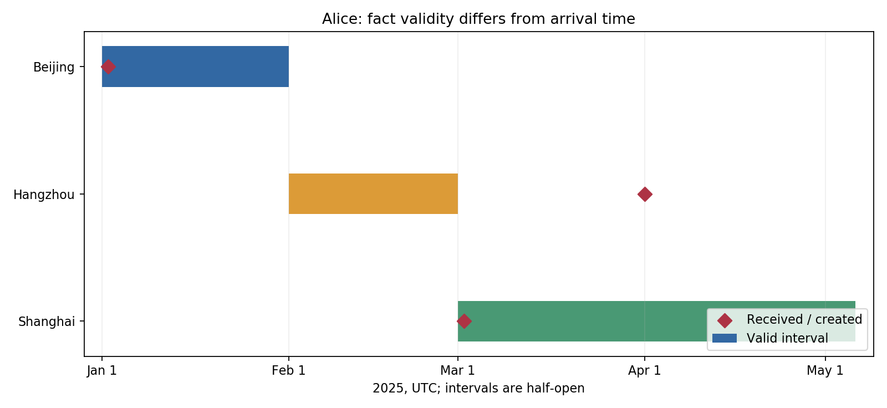

# Zep 双时间机制 demo

执行锁定 Graphiti 0.5.1 的七个原函数，观察乱序信息、区间失效和 RRF。状态为 **部分成功**，不是完整 Zep 服务或论文 benchmark 复现。

## 运行

在论文文件夹执行：

~~~powershell
& 'C:/Users/hgfhg/.cache/codex-runtimes/codex-primary-runtime/dependencies/python/python.exe' './复现/scripts/demo_zep.py'
& 'D:/anaconda/python.exe' './复现/scripts/plot_results.py'
& 'C:/Users/hgfhg/.cache/codex-runtimes/codex-primary-runtime/dependencies/python/python.exe' './复现/scripts/audit_delivery.py'
~~~

第一/三条用 bundled Python 3.12.14，demo 只依赖标准库；绘图用现有 Anaconda Python 3.7.6 + Matplotlib 3.1.3。没有 CLI 参数。无需 API key、模型、GPU、Neo4j 或服务连接。每次运行保存新的 temporal-随机ID.sqlite，results.json 指向最新一次，旧文件保留。无效日期 warning 是刻意设计的错误输入；只有末尾全部断言通过才算该次运行通过。

源码提交：77cb67cdfea7a080f217236b56f8ca39b25ca0e4。AST 加载原 resolve_extracted_edge、resolve_edge_contradictions、dedupe_extracted_edge、extract_edge_dates、get_edge_contradictions、ensure_utc、rrf，保留函数体。来源文件 SHA256 在结果中。

## 替代边界

EntityEdge/EpisodicNode 为 dataclass 接口替代；PromptAdapter 只传递任务上下文，未执行原提示词；Provider 给日期/重复/矛盾的受控响应。宿主以 user/predicate 选择候选，替代神经检索；时钟受控；semaphore_gather 用 asyncio.gather；SQLite 保存完整状态快照是教学新增。没有 package import、Graphiti 构造器、真实 add_episode、实体提取、embedding、BFS、Neo4j、社区或回答/judge LLM。所谓 user 隔离仅证明本地宿主过滤，不能当原服务权限测试。

原函数执行的范围：受控候选→去重/日期解析/矛盾筛选→时间字段修改；RRF 合并已给定列表。区间查询与事务快照属于本地演示代码。

## 实际结果

输入事件：1月北京→3月上海→4月才收到2月杭州。最终 Alice 的北京有效至2月1日、杭州有效至3月1日、上海为当前。4月晚到消息不会仅因最后写入成为当前。重复上海 UUID 不变；Bob 巴黎独立。历史日期1/2/3月查询分别北京/杭州/上海；3月1日半开边界只返回上海。

14项检查通过，16次可控响应；最终 Alice 3条、Bob 1条边。SQLite 快照重开完全一致。在接收杭州之前，“2月15日住哪里”的快照答案北京，之后为杭州。这一系统认知历史由额外快照支持，不能声称原图四字段自行保留所有旧版本。

同有效起点的矛盾边在原严格小于分支中未解决；本次记录此局限并检查确实出现。非法日期返回 None、发出 warning，也不是自动正确推断时间。

RRF 输入三路列表均把上海放第二，上海融合1.5分，其他单路第一各1分，上海排第一；余下同分采用稳定插入顺序。这不证明检索质量。

- [脚本](scripts/demo_zep.py)
- [实际 JSON 与函数来源哈希](outputs/results.json)
- [区间图](outputs/temporal.png)
- [SVG](outputs/temporal.svg)
- [论文精读](../解释.md)

未复现 DMR/LongMemEval、真实 LLM、BGE、托管服务或生产性能。不要把14个构造条件的通过率当问答准确率。

## 本轮函数契约与边界核查

在论文文件夹运行：

~~~powershell
& 'C:/Users/hgfhg/.cache/codex-runtimes/codex-primary-runtime/dependencies/python/python.exe' './复现/scripts/trace_contracts.py'
& 'C:/Users/hgfhg/.cache/codex-runtimes/codex-primary-runtime/dependencies/python/python.exe' './复现/scripts/audit_skill_revision.py'
& 'C:/Users/hgfhg/.cache/codex-runtimes/codex-primary-runtime/dependencies/python/python.exe' './复现/scripts/audit_delivery.py'
~~~

& 是 PowerShell 调用操作符；引号中的路径指定3.12解释器，后面是脚本相对论文文件夹路径。没有CLI参数或环境变量。第一条隔离执行原7函数、记录20个真实签名，覆盖16个UTC/引用/去重/候选修改/日期类型/RRF边界；第二条核对哈希、提交、签名、实测JSON与文件链接，不自动证明中文语义；第三条重查原14项、16响应和5SQLite快照，更新已修订文档哈希。

实测输出：PASS: 16 boundary checks; 20 signatures。trace不运行原main、不重建旧数据库、不覆盖原results.json。负例整数日期为AttributeError，RRF常量0为ZeroDivisionError，均有意捕获后记录；未知UUID回退或忽略，候选fact会先改，None日期保留旧区间。同起点矛盾仍未解决。输入整数绕过原response_model校验，不能泛化真实provider行为。

- [完整契约和原代码解释](../解释.md)
- [16项追踪与20签名](outputs/contracts_trace.json)
- [内容逐项核查](../资料/skill内容核查.md)
- [文件/来源一致性结果](outputs/skill_revision_check.json)

环境Windows11Pro、Python3.12.14标准库，物理可见内存15.69GiB；G盘37.28GiB空闲为本轮快照。原package import、服务、Neo4j、BGE、真实LLM、原benchmark仍未运行，状态**部分成功**。